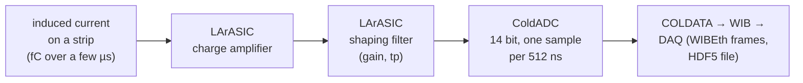
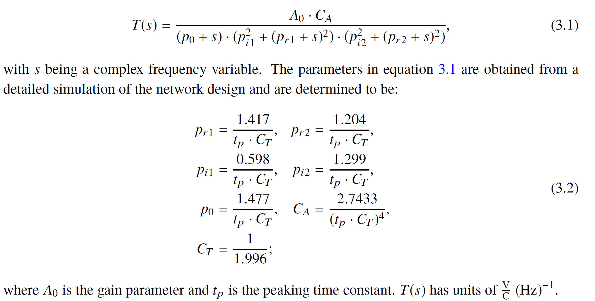
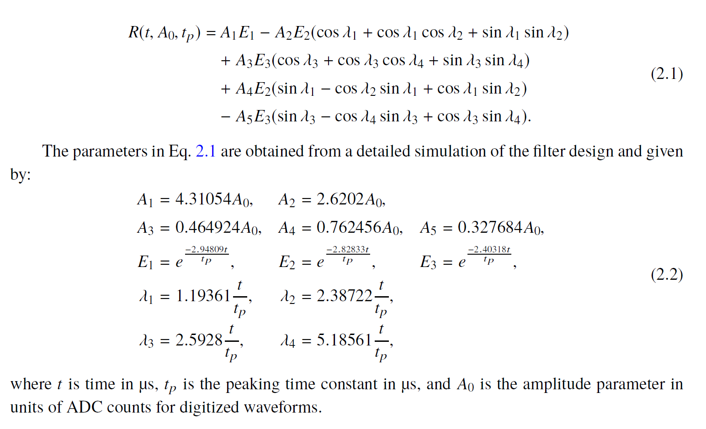
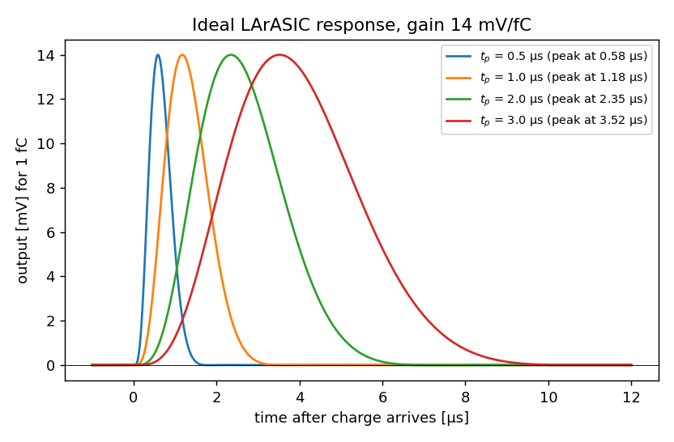
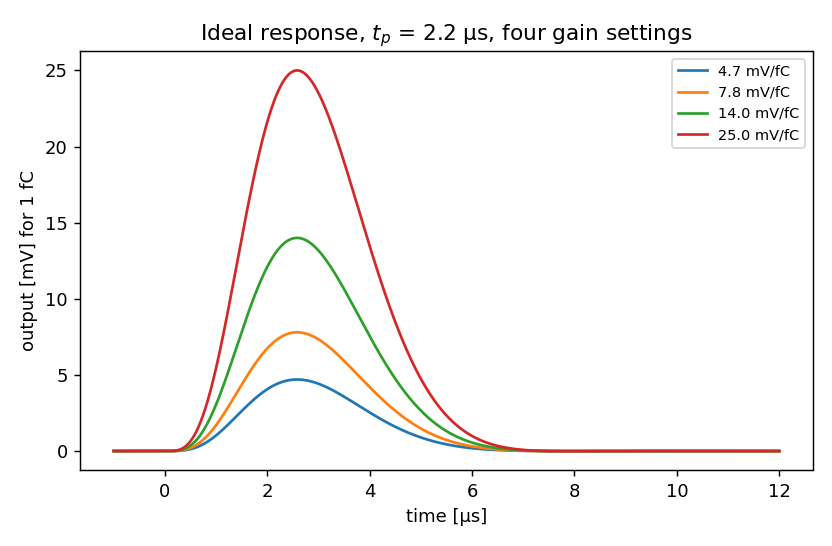
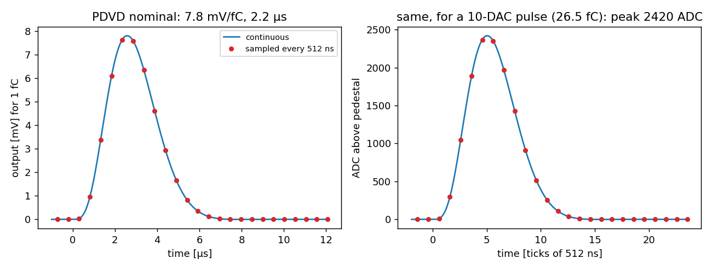
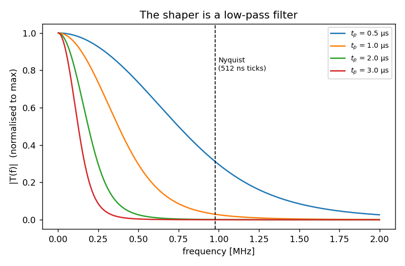

[Index](README.md) · **1 What is it** · [2 Tail](02_pole_zero_tail.md) · [3 Pulser data](03_calibration_data.md) · [4 Fitting](04_fitting_per_channel.md) · [5 Linearity](05_linearity_and_gain.md) · [6 In SP](06_correction_in_signal_processing.md) · [7 Validation](07_validation_and_running.md) · [8 Scripts](08_script_index.md) · [9 LArSoft how-to](09_running_larsoft.md) · [10 First LArSoft run](10_simple_larsoft_rawdump.md)

# 1. What is the electronics response?

## The signal chain

Ionization electrons drift to the readout strips or wires. As they approach and pass, they induce a small current on each channel. Before that current becomes the numbers in the raw data, it goes through a chain of electronics that sits in the liquid argon (hence "cold electronics"):



For ProtoDUNE-VD this chain is the **bottom drift electronics (BDE)**, which uses the same chips as ProtoDUNE-HD. The top drift uses different electronics (TDE). Wire-Cell describes the top drift with a tabulated response (`JsonElecResponse`, file `dunevd-coldbox-elecresp-top-psnorm_400.json.bz2`), and this tutorial does not cover it.

The **electronics response** is the output of the amplifier + shaper when the input is a very short current pulse carrying exactly 1 fC. Because the electronics are linear, any input current is just a sum of such short pulses. The measured waveform is therefore the input current *convolved* with the response: each tiny piece of input charge produces its own copy of the response, and the copies add up. Signal processing undoes this convolution (deconvolution, see [page 6](06_correction_in_signal_processing.md)). To do that, it must know the response well.

Two numbers describe the response:

- **gain**: the height of the output for 1 fC, in mV/fC. LArASIC settings: 4.7, 7.8, 14, 25 mV/fC.
- **peaking time `tp`**: how wide the pulse is. LArASIC settings: 0.5, 1, 2, 3 µs. The maximum comes about 1.17 × tp after the charge arrives.

The PDVD pulser scans and the current Wire-Cell configuration use **7.8 mV/fC**, with nominal `tp` **2.2 µs** (`params.jsonnet`: `gain: 7.8*wc.mV/wc.fC, shaping: 2.2*wc.us`). Some older runs used 14 mV/fC. The run-conditions database records the setting for each run (`gain`, `peak_time` fields).

## The ideal shape

The shaper is designed as a 5-pole filter: one real pole and two pairs of complex poles. In Laplace space (s = complex frequency) its transfer function is:



(from [arXiv:1705.07341](https://arxiv.org/abs/1705.07341); all pole positions scale as 1/tp, so one shape serves every peaking time). Transforming it back to time gives a closed form with five exponential/cosine terms:



In Wire-Cell this is `Response::coldelec(time, gain, shaping)` in `util/src/Response.cxx`. The `IWaveform` component that uses it is `ColdElecResponse` (`gen/src/ColdElecResponse.cxx`). The Python copy in [`script/elecresp.py`](script/elecresp.py) (`coldelec()`) is checked against the C++ source by [`script/check_formula_vs_wct.sh`](script/check_formula_vs_wct.sh). The two agree to about 1e-14 ([output](plots/check_formula_vs_wct.txt)).



*Same gain, four peaking times. A longer tp gives a wider pulse of the same height.*



*Same tp, four gains. Only the height changes.*

## What the ADC sees

The ADC samples the shaper output every 512 ns. Its 14 bits cover 0.2–1.6 V, so

  1 mV = 2^14 / 1400 mV = **11.703 ADC counts**.

For the PDVD nominal response (7.8 mV/fC, 2.2 µs), 1 fC therefore gives a peak of 7.8 × 11.703 = **91.3 ADC**. The inverse is 6241.5 e⁻ / 91.3 ADC = **68.4 electrons per ADC count**. Only about 10 samples are above 10 % of the peak:



*Left: the continuous response (line) and the 512 ns samples (dots). Right: the same in ADC counts for a 10-DAC pulser pulse (26.5 fC, see [page 3](03_calibration_data.md)).*

In frequency space the shaper is a low-pass filter: it removes high-frequency noise. Almost everything sits below the 0.98 MHz Nyquist frequency of the 512 ns sampling:



## Why signal processing cares

SP divides each channel's spectrum by (field response × electronics response). If the electronics response it divides by is wrong, the error goes straight into the reconstructed charge. The ideal shape is *almost* right for every channel. [Page 2](02_pole_zero_tail.md) shows the part that is not: a small, long tail that differs from channel to channel.

## Run it

```bash
cd script
python3 p1_ideal_response.py    # -> plots/p1_*.png
```

---
Next: [2. The tail: imperfect pole-zero cancellation →](02_pole_zero_tail.md)
