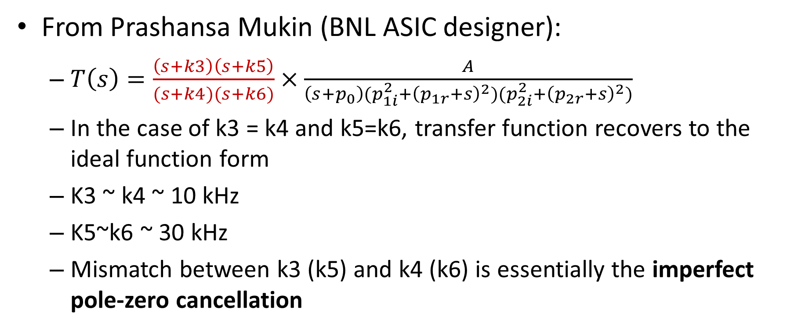
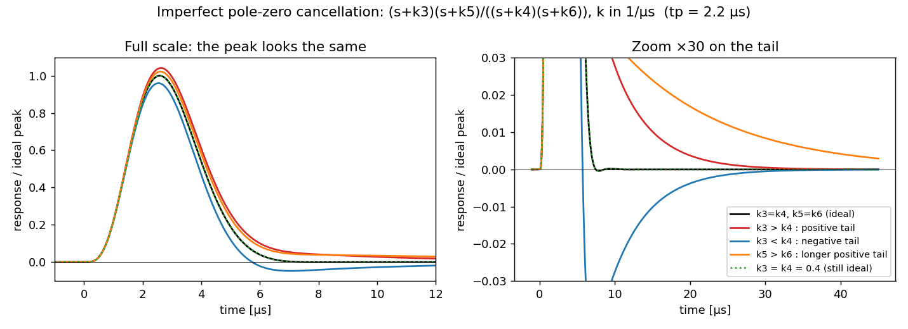
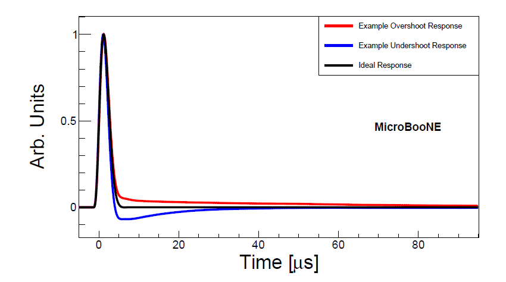
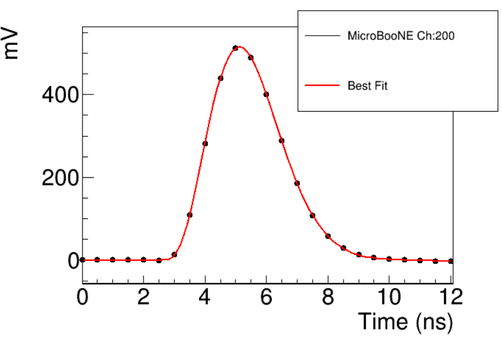
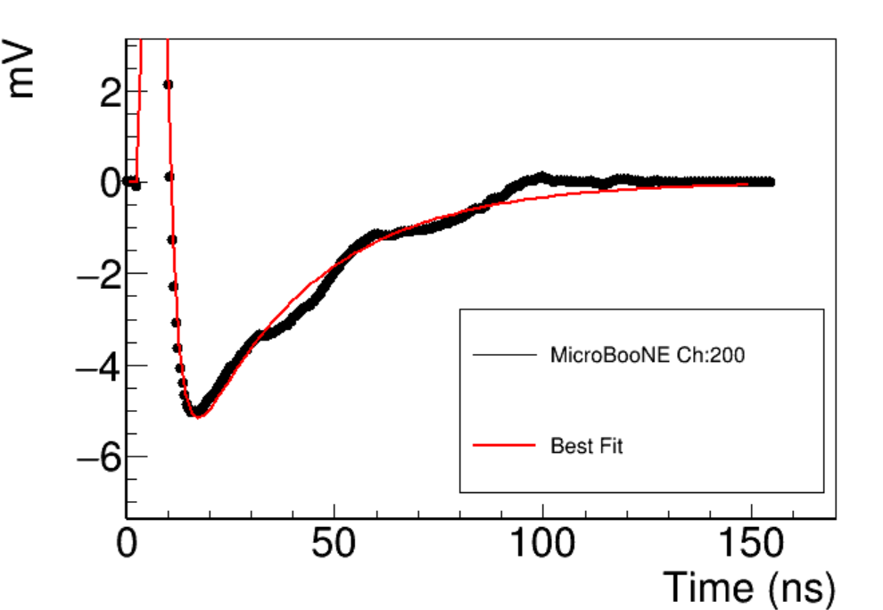
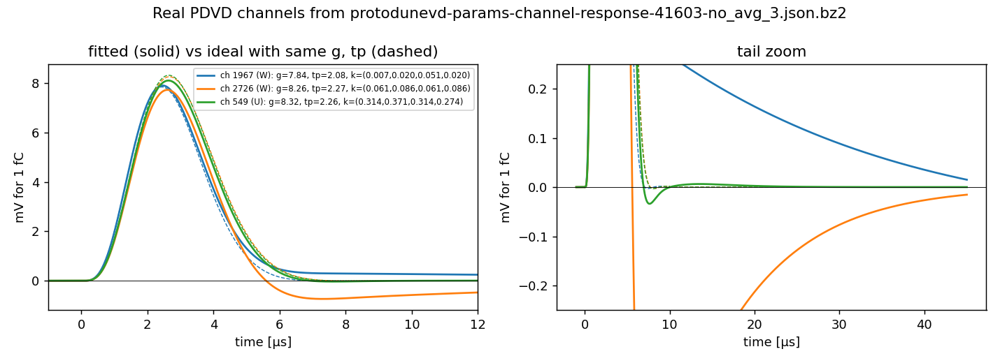
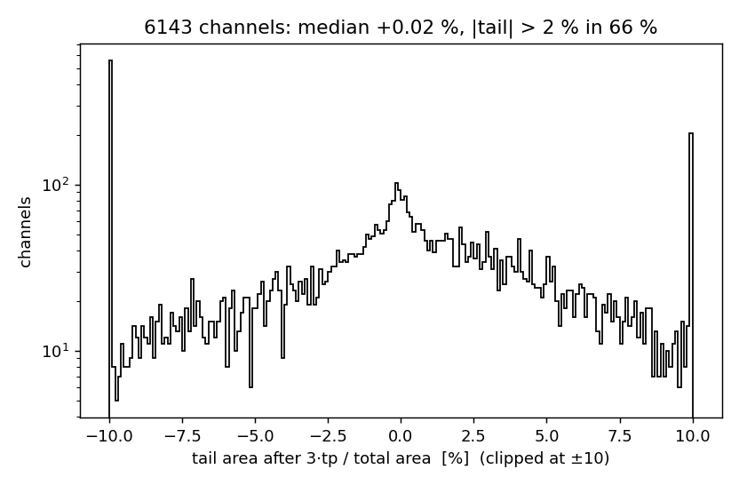
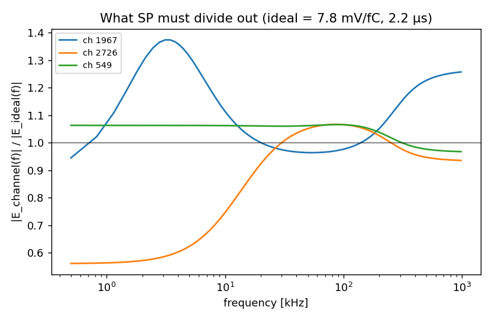

[Index](README.md) · [1 What is it](01_what_is_electronics_response.md) · **2 Tail** · [3 Pulser data](03_calibration_data.md) · [4 Fitting](04_fitting_per_channel.md) · [5 Linearity](05_linearity_and_gain.md) · [6 In SP](06_correction_in_signal_processing.md) · [7 Validation](07_validation_and_running.md) · [8 Scripts](08_script_index.md) · [9 LArSoft how-to](09_running_larsoft.md) · [10 First LArSoft run](10_simple_larsoft_rawdump.md)

# 2. The tail: imperfect pole-zero cancellation

## The idea in plain words

A charge amplifier collects the input charge on a capacitor. That charge then leaks away slowly through a feedback resistor, so on its own the amplifier output would decay over a long time. In filter language this slow decay is a **pole**. To get the output back to baseline quickly, the designers add a **zero** at the same frequency, which cancels the pole. This is called *pole-zero cancellation*.

If the zero lands exactly on the pole, the cancellation is perfect and the output is the ideal shape of [page 1](01_what_is_electronics_response.md). Real components are never exact. If the zero is slightly off, a little of the slow decay survives as a **long, small tail** after the main pulse:

- the tail is **positive** (overshoot) or **negative** (undershoot), depending on which side the zero lands;
- its length is set by the leftover pole: a decay time of about 1/k;
- its size is set by how far apart the zero and pole are.

LArASIC has two such stages. Wire-Cell parameterizes them as in X. Qian's study ([`../fit_response.pptx`](../fit_response.pptx)), based on input from the BNL ASIC designer (Prashansa Mukin):



T(s) = (s+k3)(s+k5) / ((s+k4)(s+k6)) × [ideal 5-pole shaper]

- **k3, k5** are the zeros, and **k4, k6** are the poles they are meant to cancel. All four are in units of 1/µs, so the corner frequency is k/2π.
- **k3 = k4 and k5 = k6** gives back the ideal shape exactly.
- **k3 > k4** gives a positive tail and **k3 < k4** a negative one. The same holds for the (k5, k6) pair.
- The design values are k3 ≈ k4 ≈ 10 kHz and k5 ≈ k6 ≈ 30 kHz.

In Wire-Cell this is `Response::paramscoldelec(time, gain, shaping, k3, k4, k5, k6)` (`util/src/Response.cxx:341`), wrapped by `Response::ParamsColdElec`. The C++ code is a very long closed-form inverse Laplace transform made with Mathematica. [`script/elecresp.py`](script/elecresp.py) gets the same numbers from a short sum over the seven poles (residues) and matches the C++ to 2e-14.

## What the tail looks like



*Left: at full scale the peaks barely differ. Right: zoomed ×30, the tails differ clearly. They are 1–5 % of the peak, but last tens of µs, so their area is comparable to a few percent of the pulse area. Changing k3 and k4 together (green dotted) changes nothing.*

The same thing was first seen in MicroBooNE, where some channels overshoot and some undershoot:



MicroBooNE stored a measured 310-tick waveform for each of its ~8k channels. For DUNE's much larger channel count the analytic form replaces that table with **6 numbers per channel** (gain, tp, k3, k4, k5, k6). The pptx shows the form describing a MicroBooNE channel's peak *and* tail:

| peak | tail (zoom) |
|---|---|
|  |  |

## Real PDVD channels

The fitted response file for the January 2026 scan (`protodunevd-params-channel-response-41603-no_avg_3.json.bz2`, 6144 bottom channels) contains channels with tails of both signs. Below are the most positive one, the most negative one, and a typical one. Each is compared with an ideal response that has the same gain and tp:



Over all channels, the tail area after 3·tp is spread over several percent of the total in both directions. Two-thirds of the channels have more than 2 % (the end bins collect everything beyond ±10 %):



## Why it matters for signal processing

Wire-Cell SP deconvolves a whole plane at once (2D: time *and* wire direction). That only works if every channel on the plane has **the same** electronics response. A channel with a −3 % tail reconstructs with a dip after every hit. Long tracks along the drift direction (many overlapping hits) collect a sizeable charge bias.

In frequency space the difference sits mostly at **low frequency** (below ~20 kHz), which is the long tail. A gain/shape difference near the peak shows up as an overall offset:



*|E_channel(f)| / |E_ideal(f)|, the factor each channel's data must be divided by. [Page 6](06_correction_in_signal_processing.md) shows how SP does this.*

### The k4 = k6 trap

The closed-form C++ divides by (k4 − k6). If a fit lands with **k4 exactly equal to k6**, that channel's response is NaN at every sample. In SP that one NaN channel spreads through the wire-direction FFT and silently wipes out the whole plane (zero charge, no error message). Known cases: channel 3209 in `41603-no_avg_3`, and 5 and 7 channels in `41573-no_avg_4` and `41602-no_avg_3`. Section 7 of [`../NFSP_PCRESP_NOTE.md`](../NFSP_PCRESP_NOTE.md) has the full story, and `regen_chresp_tick.py --check/--fix-pole` finds and fixes these channels ([page 6](06_correction_in_signal_processing.md)). `check_formula_vs_wct.sh` includes such a channel as set 3: the C++ and Python both return NaN there.

## Run it

```bash
cd script
python3 p2_pole_zero_tail.py ../data/protodunevd-params-channel-response-41603-no_avg_3.json.bz2
#   optional: --channels 100 1200 2000   to choose the example channels
```

---
← [1. What is it](01_what_is_electronics_response.md) · Next: [3. Calibration data from the pulser →](03_calibration_data.md)
