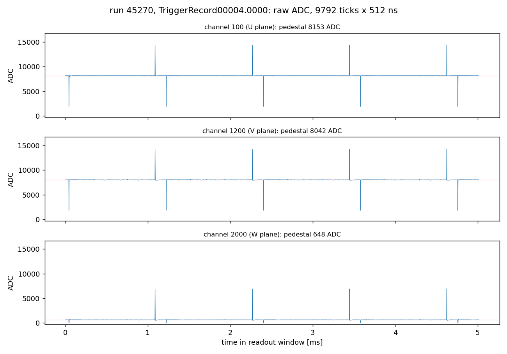
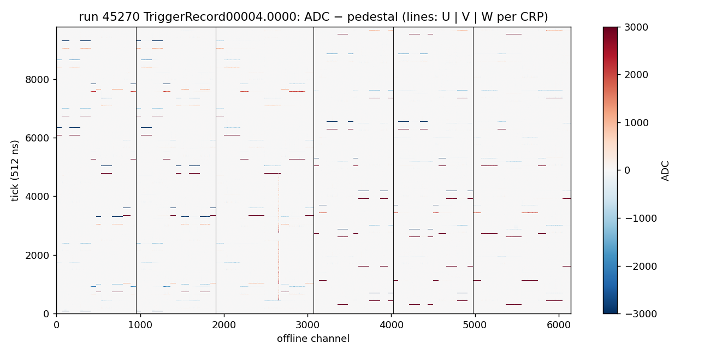
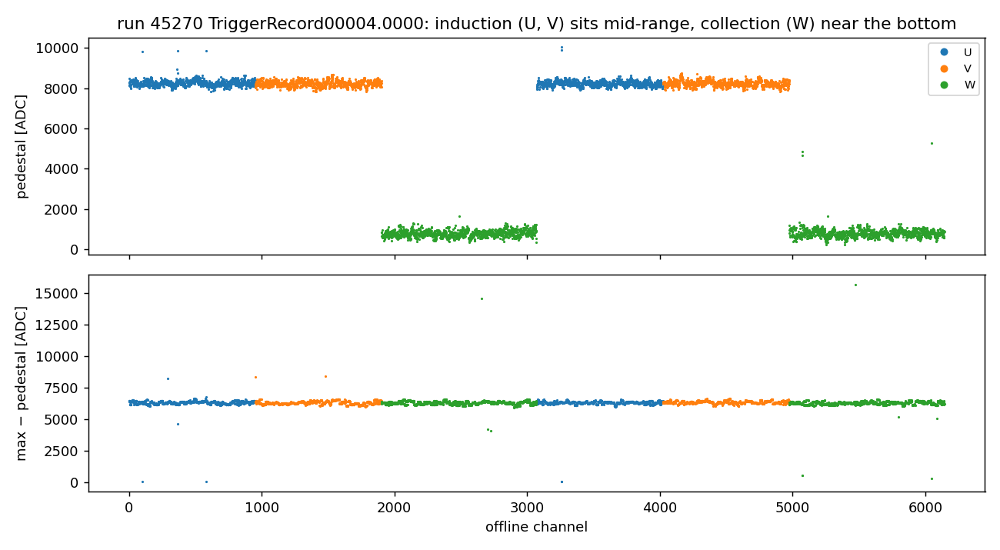
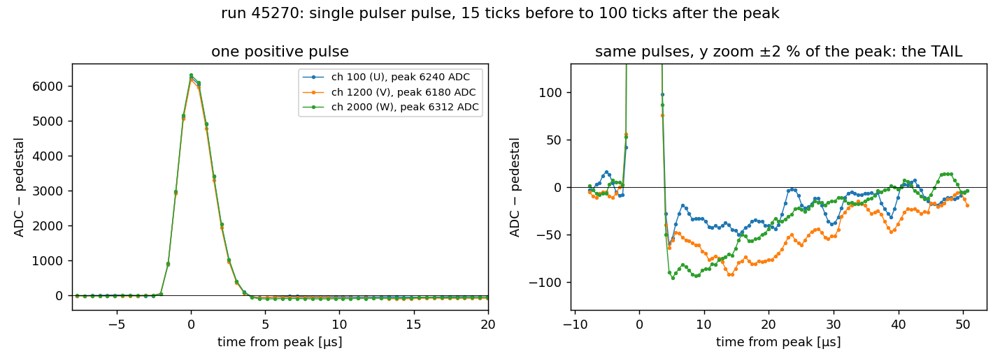
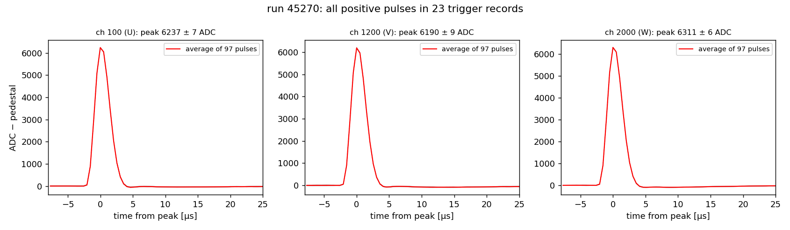

[Index](README.md) · [1 What is it](01_what_is_electronics_response.md) · [2 Tail](02_pole_zero_tail.md) · **3 Pulser data** · [4 Fitting](04_fitting_per_channel.md) · [5 Linearity](05_linearity_and_gain.md) · [6 In SP](06_correction_in_signal_processing.md) · [7 Validation](07_validation_and_running.md) · [8 Scripts](08_script_index.md) · [9 LArSoft how-to](09_running_larsoft.md) · [10 First LArSoft run](10_simple_larsoft_rawdump.md)

# 3. Calibration data from the cold-electronics pulser

## How the BDE injects a known charge

Every LArASIC channel has a built-in **test pulser**. A programmable voltage step from a DAC (a small digital-to-analog converter) is applied across a small **injection capacitor CC** connected to the channel input. A voltage step V across a capacitor pushes a charge Q = CC × V into the amplifier, the same thing a real ionization signal does, but with a known charge and at a known time.

With the 7.8 mV/fC gain setting one DAC step is dac_du = 14.33 mV, and CC = 185 fF, so

  Q per DAC step = 1.85×10⁻¹³ F × 14.33×10⁻³ V = **2.651 fC** (= 16 548 electrons).

The pulser drives a periodic voltage step. Its rising edge injects +Q (a **positive** pulse) and its falling edge −Q (a **negative** pulse). In a calibration run every channel is pulsed, and the DAQ writes the data to the `calibration` stream.

Calibration campaigns repeat this at several DAC settings (a **DAC scan**). The scans used here:

| PDVD run | 41573 | 41574 | 41577 | 41582 | 41587 | 41593 | 41597 | 41602 | 41603 |
|---|---|---|---|---|---|---|---|---|---|
| DAC | 1 | 2 | 5 | 10 | 15 | 21 | 25 | 30 | 31 |
| Q (fC) | 2.65 | 5.30 | 13.26 | 26.51 | 39.77 | 55.67 | 66.28 | 79.53 | 82.18 |

| PDHD run | 30367 | 30376 | 30385 | 30394 | 30404 | 30413 | 30421 | 30430 |
|---|---|---|---|---|---|---|---|---|
| DAC | 5 | 10 | 15 | 20 | 25 | 30 | 35 | 40 |

(from [`../20260701.pdf`](../20260701.pdf), slide 2. HD DAC values are from the run-conditions database via `calib_chain/get_pulser_dac.py`. The VD database rows have no `pulse_dac`, so the VD values come from the run plan.)

One run at one DAC is enough to measure the **shape** of each channel's response ([page 4](04_fitting_per_channel.md)). To measure the **gain** and check **linearity**, you need the whole scan ([page 5](05_linearity_and_gain.md)).

## The example file: run 45270

`np02vd_raw_run045270_0000_df-s04-d0_dw_0_20260929T175649.hdf5` (2.4 GB):

- 23 trigger records, 96 TPC links (`Detector_Readout_0x..._WIBEth`), bottom drift only: crates 10 and 11, 6 WIBs each, 8 streams × 64 channels = **6144 channels**;
- 9792 samples of 512 ns per channel per record (**5.0 ms**);
- positive pulses every **2303 ticks** (1.18 ms), each followed about 270 ticks later by the negative pulse;
- positive pulse height **≈ 6300 ADC** on all three planes. The DAC setting is not in the run-conditions database for this run: its latest entry is run 43990. If the gain was 7.8 mV/fC, this corresponds to about DAC 26 ([page 5](05_linearity_and_gain.md)).

### Reading the raw HDF5 without LArSoft

[`script/pdvd_hdf5_decode.py`](script/pdvd_hdf5_decode.py) decodes the file with `h5py` + `numpy` alone:

```
fragment  = 72-byte header + N frames of 7200 bytes
frame     = DAQEthHeader word (det_id, crate, slot, stream) + timestamp word (16 ns ticks)
            + 2 WIBEth header words
            + 64 time samples × 14 uint64 words = 64 channels × 14-bit ADC, packed little-endian
offline channel = PD2VDTPCChannelMap_v2.txt[(crate, slot, stream, stream-channel)]
```

The channel map is the official one shipped with `duneprototypes` on `/cvmfs`; set `PDVD_CHANMAP` to use another copy. One record decodes in about 1 s.

```bash
python3 script/pdvd_hdf5_decode.py FILE.hdf5          # summary of record 0
```

The LArSoft route (HDF5 → `tpcrawdecoder:daq` RawDigits) is used by the calibration chain on [page 7](07_validation_and_running.md) (`calib_chain/run_nf_elec_calib_vd_hdf5.fcl`).

## What pulser data look like



*One trigger record, one channel per plane. Induction planes (U, V) sit in the middle of the ADC range (pedestal ≈ 8200), so both polarities fit. The collection plane (W) sits near the bottom (pedestal ≈ 800), so **its negative pulses are clipped at ADC 0**. Use the positive pulses.*



*All 6144 channels (pedestal subtracted). The pulses are not simultaneous on all channels: groups of channels are pulsed at different times. One noisy channel near 2650 is visible.*



*Per channel: pedestal (top) and largest sample above pedestal (bottom). Pulse heights are uniform to a few percent. The few outliers are dead or odd channels; 4 channels have no pulses at all.*

## The target of the correction: the tail

Zoom in on one pulse. The main peak looks like the ideal shape of page 1. Zooming to ±2 % of the peak shows a **negative tail** of about −1 % (−50 to −90 ADC) that takes about 40 µs to recover. Its size differs from channel to channel. This tail is what [page 2](02_pole_zero_tail.md) explains, and what the correction removes:



The wiggles on the tail are noise (no noise filter is applied here). Averaging the ~97 positive pulses a channel has in the 23 records removes most of it. The pulser is very stable, with a pulse-to-pulse spread of the peak of only about ±7 ADC (0.1 %):



## Run it

```bash
cd script
python3 p3_raw_pulser.py /path/to/np02vd_raw_run045270_...hdf5 [--channels 100 1200 2000]
# -> plots/p3_full_readout.png p3_event_display.png p3_one_pulse.png p3_pulse_stack.png p3_amplitude_map.png
```

The pulse stack decodes all 23 records and takes about 1.5 min on NFS (`--nrec 5` makes it faster).

---
← [2. Tail](02_pole_zero_tail.md) · Next: [4. Fitting one response per channel →](04_fitting_per_channel.md)
