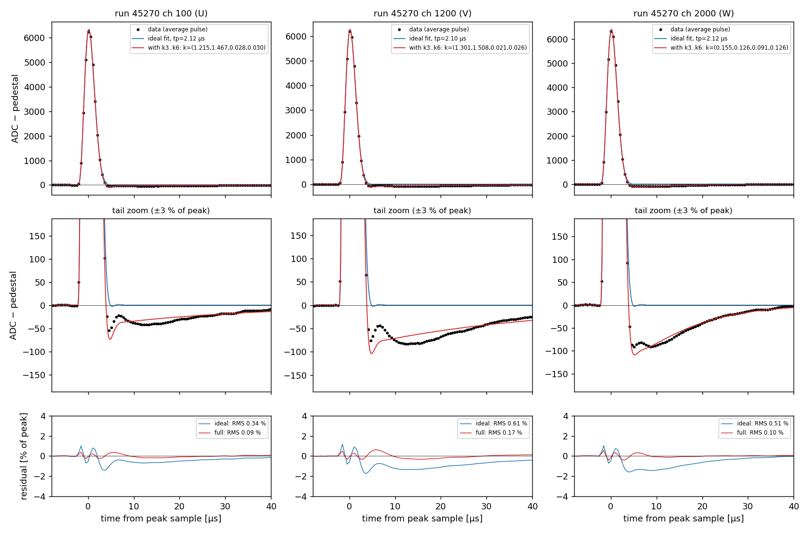
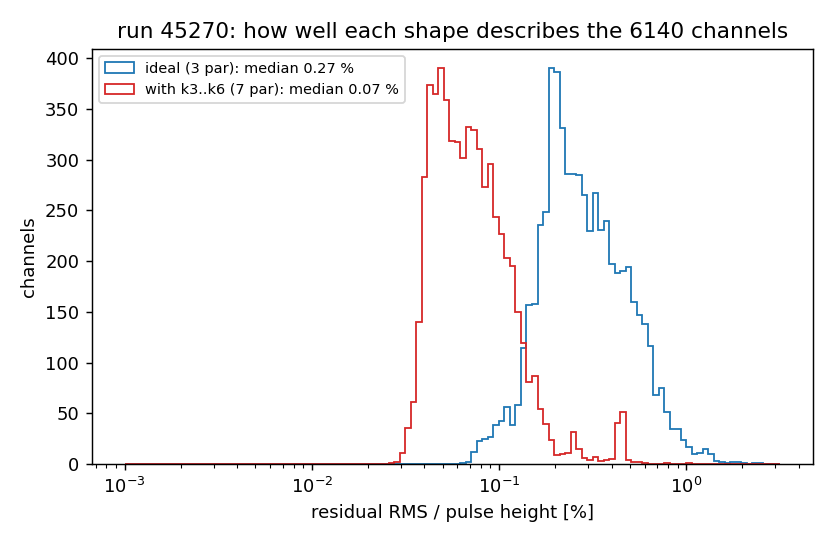
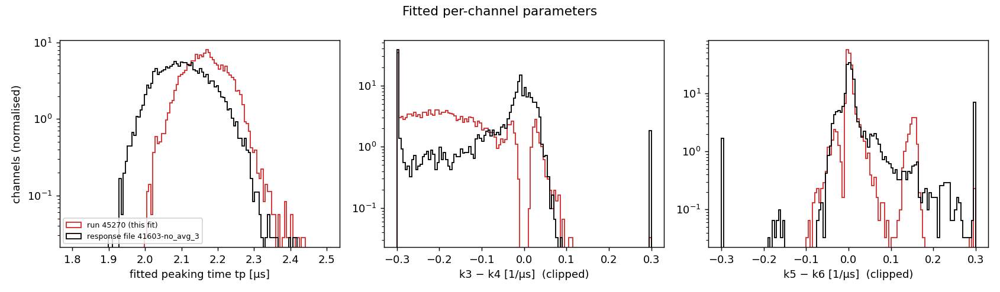
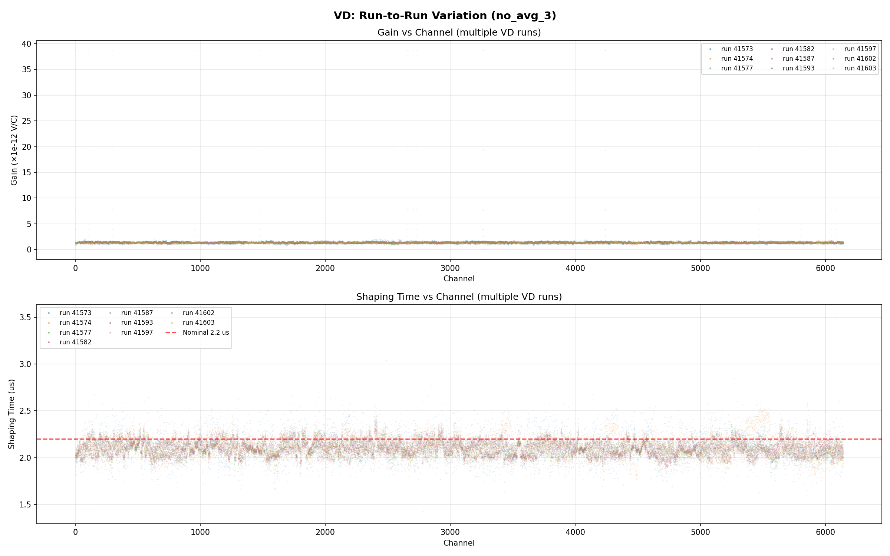
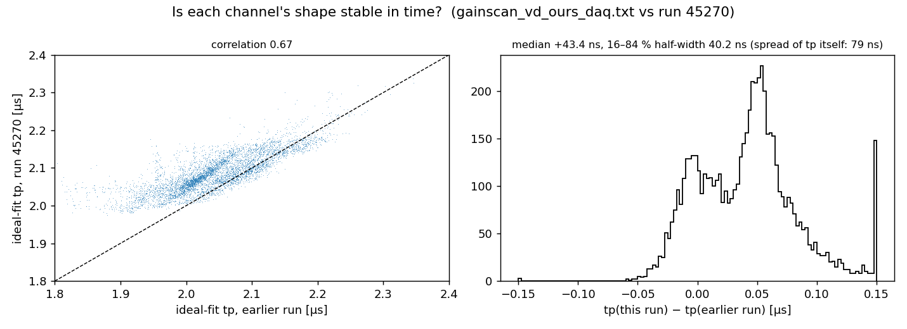

[Index](README.md) · [1 What is it](01_what_is_electronics_response.md) · [2 Tail](02_pole_zero_tail.md) · [3 Pulser data](03_calibration_data.md) · **4 Fitting** · [5 Linearity](05_linearity_and_gain.md) · [6 In SP](06_correction_in_signal_processing.md) · [7 Validation](07_validation_and_running.md) · [8 Scripts](08_script_index.md) · [9 LArSoft how-to](09_running_larsoft.md) · [10 First LArSoft run](10_simple_larsoft_rawdump.md)

# 4. Fitting one response per channel

The goal: for every channel, the 6 numbers (gain, tp, k3, k4, k5, k6) that turn the analytic form of [page 2](02_pole_zero_tail.md) into that channel's measured pulse.

## Step 1: one clean average pulse per channel

[`script/make_avg_pulses.py`](script/make_avg_pulses.py) loops over all trigger records. For each one it:

1. decodes every channel and subtracts the median (the pedestal);
2. finds every positive peak above half of the channel's maximum;
3. cuts 15 ticks before to 200 ticks after the peak sample (−7.7 µs to +102 µs);
4. averages all cuts.

The window is longer than the 100 ticks the ROOT fitter uses (see below) because the tail lasts that long. The next (negative) pulse comes about 270 ticks later, so 200 ticks is safe. For run 45270 this averages a median of 95 pulses per channel in 35 s, and the output is `data/avg_pulses_run45270.npz`.

## Step 2: two fits per channel

[`script/p4_fit_pulses.py`](script/p4_fit_pulses.py) fits every channel twice, in parallel, with `scipy.optimize.least_squares`:

| fit | model | free parameters |
|---|---|---|
| ideal | A · coldelec(t − t0; tp) | t0, A, tp |
| per-channel | A · paramscoldelec(t − t0; tp, k3, k4, k5, k6) | t0, A, tp, k3, k4, k5, k6 |

Fitting details that matter:

- **The k's are not unique.** Swapping the pairs (k3, k4) ↔ (k5, k6) gives exactly the same T(s). The script tries three starting points, keeps the best, and then orders the pairs so the faster pole (larger k4) comes first. Otherwise parameter histograms from different fitters cannot be compared.
- **Never start with k4 = k6** (the pole trap of page 2).
- **The amplitude A is in ADC.** It becomes a gain in mV/fC only once you know the injected charge: gain = A / (Q × 11.703). Run 45270's charge is not recorded, so this page compares **shapes**, and gain is the topic of [page 5](05_linearity_and_gain.md).



*Run 45270, one channel per plane. Top: average pulse (dots), ideal fit (blue), 7-parameter fit (red). Middle: tail zoom, where the ideal shape goes to zero while the data stay ≈ −1 % for 30 µs; the 7-parameter form follows the tail. Bottom: residuals.*



Over all 6140 channels with pulses, the residual RMS drops from **0.27 %** of the peak (ideal) to **0.07 %** (7 parameters). What is left is a small wiggle 4–8 µs after the peak, which the analytic form does not include. It is well below the 1 % tail being corrected.



*Fitted tp and the zero–pole mismatches k3−k4 and k5−k6 for run 45270 (red), compared with the January response file `41603-no_avg_3` (black). Both show mismatches of either sign. A mismatch of zero means a perfectly cancelled stage.*

## The production fits: response files

The response files Wire-Cell uses were fitted by K. Tellez Giron Flores from the January 2026 scan runs. They live in `/exp/dune/data/users/ktellez/wf_correction/wc-params/`, and copies are in the toolkit config (`cfg/pgrapher/experiment/protodunevd/`) and in [`data/`](data/). Her magnify files and ROOT macros are the source; this folder has `calib_chain/wf_fitter_VD_DECON.C` (pulse finding + the 3-parameter ideal fit) but not the fitter that writes the k3..k6 parameters.

Format (`protodunevd-params-channel-response-41603-no_avg_3.json.bz2`):

```
{ "tick": 512.0, "t0": -2750.0, "nsamp": 100,           # sampling grid, ns
  "channel_info": [
     { "channels": [0], "gain": 1.29431e-12, "shaping": 2024.52,
       "k3": 0.1713106, "k4": 0.1279436, "k5": 0.0861815, "k6": 0.1279443 },
     ... 6144 entries ... ] }
```

- `gain` is in Wire-Cell internal units. Divide by (wc.mV/wc.fC) = 1.602177×10⁻¹³ to get mV/fC: 1.294×10⁻¹² → **8.08 mV/fC**. Over the file the median is 8.14 mV/fC.
- `shaping` is tp in ns (median 2105 ns, spread 71 ns).
- `k3..k6` are in 1/µs.
- No waveform is stored. `ParamsPerChannelResponse` evaluates `ParamsColdElec` on the grid `Binning(nsamp, t0, t0+nsamp·tick)` when it loads. **The grid must match the frame tick of the job that uses it** ([page 6](06_correction_in_signal_processing.md)).

`elecresp.load_chresp()` reads these files and converts the units. Earlier work plotted every parameter against channel for all nine January runs, and they agree well run to run:



## Is a channel's shape stable over time?

Run 45270 (September 2026) can be compared with the January scan. The comparable quantity is the **ideal-fit tp**, which both fitters measure the same way. The January value is the `tp_ref` column of `data/gainscan_vd_ours_daq.txt`, from the ROOT gain scan before any correction:



- Each channel's tp is clearly **remembered** (correlation 0.67; the channel-to-channel spread is 79 ns).
- September is on average **43 ns longer**, and the differences split into two groups: about 0 and about +55 ns.
- The fitters also differ (window, pedestal estimate), so part of the shift may be method rather than hardware.

Practical advice: a response file from one campaign is a good, but not perfect, description months later. [Page 6](06_correction_in_signal_processing.md) applies the January file to this September run and shows how well it still works. For the best result, take a fresh DAC scan.

## Run it

```bash
cd script
python3 make_avg_pulses.py /path/to/run045270.hdf5 -o ../data/avg_pulses_run45270.npz
python3 p4_fit_pulses.py ../data/avg_pulses_run45270.npz \
        --chresp ../data/protodunevd-params-channel-response-41603-no_avg_3.json.bz2 \
        --tpref  ../data/gainscan_vd_ours_daq.txt --nproc 32
# -> ../data/fit_run45270.npz, plots/p4_*.png   (~30 s on 32 cores)
```

The ROOT equivalent of the ideal fit, as used in the earlier validation, is `calib_chain/wf_fitter_ideal.C("hraw-pdvd-magnify-<run>-<evt>.root","vd",<run>)`. It reads a magnify TH2 made by `calib_chain/vd_convert_artroot_raw.C` ([page 7](07_validation_and_running.md)).

---
← [3. Pulser data](03_calibration_data.md) · Next: [5. Gain and linearity →](05_linearity_and_gain.md)
