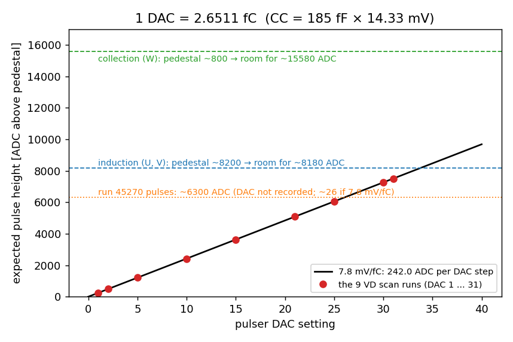
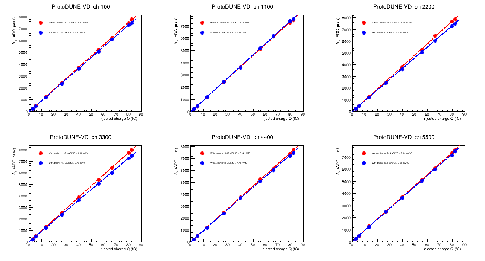
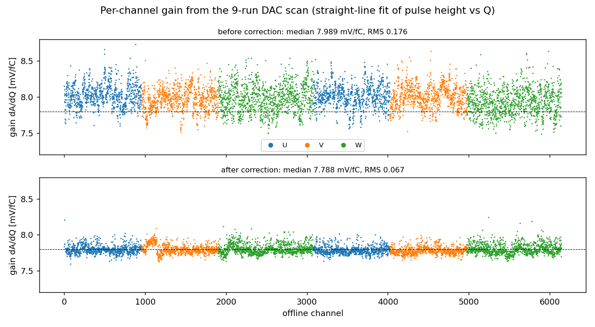
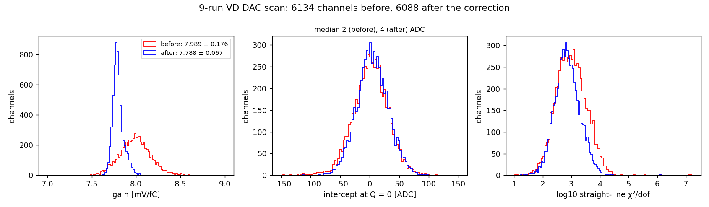

[Index](README.md) · [1 What is it](01_what_is_electronics_response.md) · [2 Tail](02_pole_zero_tail.md) · [3 Pulser data](03_calibration_data.md) · [4 Fitting](04_fitting_per_channel.md) · **5 Linearity** · [6 In SP](06_correction_in_signal_processing.md) · [7 Validation](07_validation_and_running.md) · [8 Scripts](08_script_index.md) · [9 LArSoft how-to](09_running_larsoft.md) · [10 First LArSoft run](10_simple_larsoft_rawdump.md)

# 5. Gain and linearity from a DAC scan

A single run such as 45270 tells you the *shape* of each channel's response. It cannot tell you whether the pulse height grows in proportion to the charge (**linearity**), or the height per fC (**gain**), unless you trust the injected charge of that one point. For both you need **several runs at different DAC settings**: the scan of [page 3](03_calibration_data.md).

## What the scan should give

The arithmetic chain is DAC → charge → mV → ADC:

  1 DAC = 2.651 fC;  × 7.8 mV/fC = 20.7 mV;  × 11.703 ADC/mV = **242 ADC per DAC step** (true peak).

The six example channels on slide 5 of the 1 July 2026 slides ([Sources](README.md#sources)) measure 242–257 ADC/DAC, as expected.



*The 14-bit ADC limits the scan. Induction channels sit at a pedestal of ≈ 8200, leaving room for about 8180 ADC, which is about DAC 33 at 7.8 mV/fC. That is why the VD scan stops at DAC 31. Collection channels have about twice the room.*

## How the scan is analysed

These are the ROOT macros in `script/calib_chain/` (they run inside the SL7 container; see [page 7](07_validation_and_running.md)):

1. `reprocess_vd_scan.sh` runs each of the 9 runs through the calibration NF job and writes `ourmag-pdvd-<run>-<evt>.root`. That file holds two TH2s from the **same** job: `h_daq` (raw, uncorrected) and `h_raw` (after the per-channel correction).
2. `wf_gain_scan_ours.C+("vd","daq")` and `("vd","raw")`: for every channel and run, fit the pulse with the ideal shape, then fit a straight line of pulse height vs Q. The slope is the gain, written to `txt_files/gainscan_vd_ours_{daq,raw}.txt` with columns `ch slope(mV/fC) slope_err slope_adc(ADC/fC) intercept tp_ref npoints line_chi2dof`.
3. `plot_gain_tp_ours.C("vd")` draws the gain and tp histograms, and `plot_charge_vs_a0_ours.C("vd","both")` draws the per-channel lines.



*Pulse height vs injected charge for six channels, before (red) and after (blue) the correction. Each is a straight line through 9 points from 2.65 to 82 fC.*

## Results over all channels

[`script/p5_linearity.py`](script/p5_linearity.py) reads the two tables (copies are in [`data/`](data/)):





| | before correction | after correction |
|---|---|---|
| gain (median ± RMS) | **7.99 ± 0.18 mV/fC** | **7.79 ± 0.07 mV/fC** |
| intercept at Q = 0 (median) | +2 ADC | +4 ADC |
| intercept, 95 % of channels within | −57 … +58 ADC | −46 … +58 ADC |
| channels (slope between 5 and 11 mV/fC) | 6134 | 6088 |

- **Linear.** For 95 % of the channels the intercept is within about ±60 ADC of zero, under 1 % of the ≈ 7600 ADC top point, so the electronics are linear over the 2.65–82 fC range.
- **The gain is 7.8 mV/fC, as set.** After the correction every channel has been moved to the nominal response, so the spread shrinks by a factor 2.6 and the median sits at 7.79.
- The χ²/dof of the line is large (~10³) because only the small statistical error of each pulse fit is used. Use the intercept and the residuals, not χ², to judge linearity.

Two traps found along the way (agent log 2026-06-25):

- The ROOT ideal shape `response_legacy` peaks at **0.1 × A0**, so its fitted A0 is 10 × the pulse height. Older tables (`gainscan_vd_daq.txt`) quote slopes around 920 "ADC/fC". That is 92 ADC/fC × 10, not a 10× gain.
- An early version mixed two separately produced magnify files for before/after and showed a fake 2.3× gain jump. Always build before and after from the **same** job (`vd_convert_orig_raw.C`).

## Doing the same for new data (e.g. around run 45270)

Run 45270 is one DAC point. To check linearity for the September 2026 period:

1. take (or find) runs at several DAC values in the same configuration, ideally spanning DAC 1–31;
2. for each run, `script/make_avg_pulses.py` + `script/p4_fit_pulses.py` give the per-channel pulse height (the fitted `A`, or the peak of the fitted shape);
3. fit height vs Q = DAC × 2.651 fC per channel. The slope / 11.703 is the gain in mV/fC, and the intercept and residuals test linearity.

## Units cheat sheet

| quantity | value |
|---|---|
| ADC per mV (14 bit over 0.2–1.6 V) | 11.703 |
| charge per DAC step (CC = 185 fF, 14.33 mV) | 2.651 fC = 16 548 e⁻ |
| 1 fC | 6241.5 e⁻ |
| peak for 1 fC at 7.8 mV/fC | 91.3 ADC |
| electrons per ADC at 7.8 mV/fC | 68.4 |
| expected peak per DAC step | 242 ADC |

## Run it

```bash
cd script
python3 p5_linearity.py ../data/gainscan_vd_ours_daq.txt ../data/gainscan_vd_ours_raw.txt
```

---
← [4. Fitting](04_fitting_per_channel.md) · Next: [6. Using the result in signal processing →](06_correction_in_signal_processing.md)
