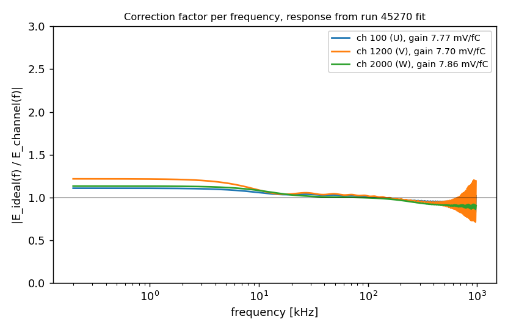
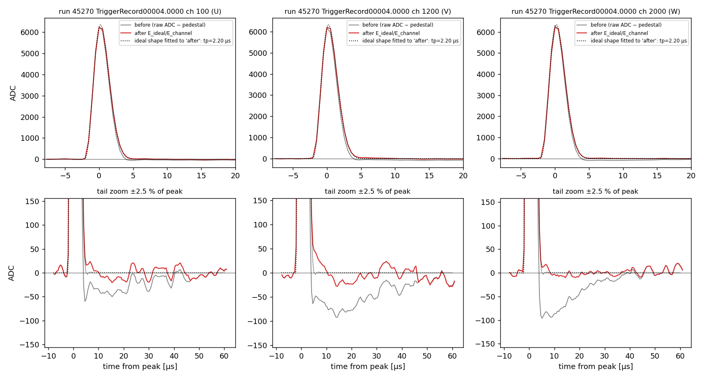
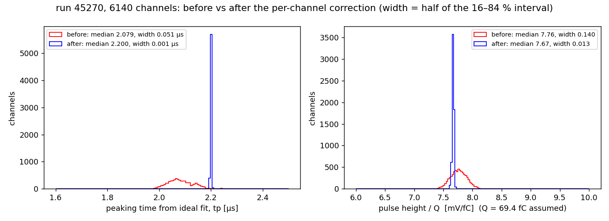
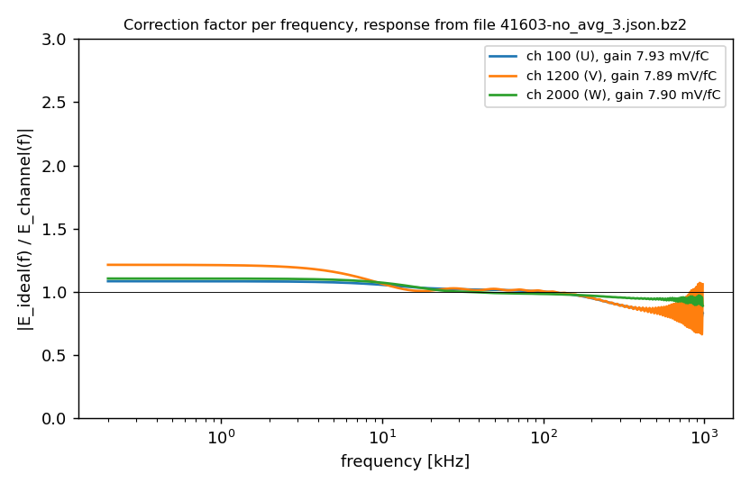
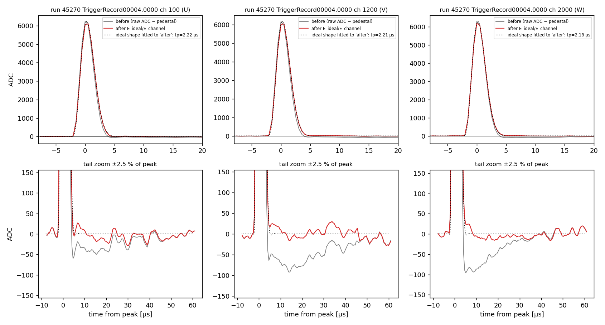
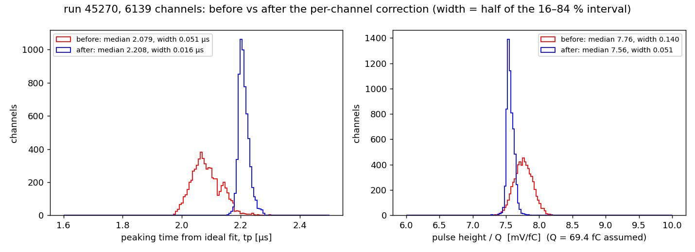

[Index](README.md) · [1 What is it](01_what_is_electronics_response.md) · [2 Tail](02_pole_zero_tail.md) · [3 Pulser data](03_calibration_data.md) · [4 Fitting](04_fitting_per_channel.md) · [5 Linearity](05_linearity_and_gain.md) · **6 In SP** · [7 Validation](07_validation_and_running.md) · [8 Scripts](08_script_index.md) · [9 LArSoft how-to](09_running_larsoft.md) · [10 First LArSoft run](10_simple_larsoft_rawdump.md)

# 6. Using the result in signal processing

## The idea: swap the response, don't remove it

Wire-Cell SP deconvolves each plane with **one** response: field response × the nominal electronics response (7.8 mV/fC, 2.2 µs for the PDVD bottom). It cannot use a different response for every row, because the 2D deconvolution also transforms along the wire direction.

So before deconvolving, each channel's data are brought to the nominal response. In frequency space this is one multiplication per channel:

  **spectrum_ch(f) × E_ideal(f) / E_channel(f)**

E_channel comes from the response file (the fitted gain, tp, k3..k6 of that channel) and E_ideal is the nominal `ColdElecResponse`. Dividing by E_channel removes the channel's own response, tail included, and multiplying by E_ideal puts back the response the rest of SP assumes. Afterwards every channel looks as if it had the ideal electronics, including the gain: a channel at 8.3 mV/fC is scaled down to 7.8.

This swap is **not idempotent**. Applied twice it gives (E_ideal/E_channel)², so it must happen in **exactly one place**.

## Where it lives in the code

| place | component | purpose |
|---|---|---|
| **SP** (production) | `OmnibusSigProc::decon_2D_init()`, `sigproc/src/OmnibusSigProc.cxx`, enabled by the `per_chan_resp` setting | applied to the data right after the time FFT, before the wire FFT |
| NF (validation only) | `perChannelShaper` = `ResponseShaper::OneChannelResponse`, `sigproc/src/ResponseShaper.cxx` | the same swap inside the noise filter, used to look at the corrected waveforms of pulser runs; its header says "implemented for validation purpose" |
| per-channel responses | `ParamsPerChannelResponse`, `sigproc/src/ParamsPerChannelResponse.cxx` | reads the response file, builds `Response::ParamsColdElec` for each channel on the file's grid |
| nominal response | `ColdElecResponse`, `gen/src/ColdElecResponse.cxx` | `Response::coldelec` with the gain and shaping from `params.jsonnet` |

The core of `decon_2D_init` (abridged):

```cpp
m_c_data[plane] = dft_fwd_r2c(m_r_data[plane], 1);          // FFT along time
if (!m_per_chan_resp.empty()) {
    auto cr = Factory::find_tn<IChannelResponse>(m_per_chan_resp);
    auto cr_bins = cr->channel_response_binning();
    if (cr_bins.binsize() != m_period) THROW(...);           // response grid must equal the tick
    WireCell::Binning tbins(m_fft_nticks, cr_bins.min(), cr_bins.min() + m_fft_nticks * m_period);
    auto elec = dft_fwd_r2c((*m_elecresponse).waveform_samples(tbins));   // E_ideal
    ... ch_elec_2d = FFT of each channel's response, zero-padded ...       // E_channel
    m_c_data[plane](irow, icol) *= elec.at(icol) / ch_elec_2d(i, icol);   // the swap
}
fwd_inplace(m_dft, m_c_data[plane], 0);                     // FFT along wires
```

Both responses are sampled from the same start time (`t0 = −2.75 µs` from the file header), so the time offset cancels in the ratio and no shift is introduced.

## Configuration (PDVD, dunesw v10_26)

Two one-line edits to the release `wire-cell-cfg` switch the correction on. The full recipe is in [`../NFSP_PCRESP_NOTE.md`](../NFSP_PCRESP_NOTE.md), and the edited files are in `script/sp_chain/cfg_v10_26/`.

| file | edit |
|---|---|
| `pgrapher/experiment/protodunevd/params.jsonnet` | `chresp: null,` → `chresp: "protodunevd-params-channel-response-41603-no_avg_3-500ns.json.bz2",` |
| `pgrapher/experiment/protodunevd/sp.jsonnet` | `per_chan_resp: pc.name,` → `per_chan_resp: if anode.data.ident < 4 then pc.name else '',` |

Things that must be right:

1. **Bottom drift only.** The file covers channels 0–6143 (anodes 0–3), and `ParamsPerChannelResponse` **throws** on a channel it does not know, with no fallback to nominal. Hence the anode gate.
2. **Same tick as the frame.** The fit was done at 512 ns, but the chain runs SP at 500 ns (resampler on). `OmnibusSigProc` throws if `cr_bins.binsize() != m_period`. Re-grid the file with `script/sp_chain/regen_chresp_tick.py IN.json.bz2 --tick 500 --fix-pole`. This is exact, not an interpolation, because the file stores parameters and not waveforms: only `tick` and `nsamp` change (512 → 500 ns, 100 → 103 samples).
3. **No k4 = k6 channel** ([page 2](02_pole_zero_tail.md)): `--check` reports such channels and `--fix-pole` nudges k6 by 10⁻⁶.
4. The response file is found **by basename on `WIRECELL_PATH`**, so put its directory on the path.
5. Release jsonnets import their siblings by relative path, so an overlay holding only the two edited files is silently ignored. Use a **full copy** of `wire-cell-cfg` (`sp_chain/run_nfsp.sh` builds one automatically).

## Demonstration on real pulser data

[`script/p6_apply_correction.py`](script/p6_apply_correction.py) does exactly the ResponseShaper/OmnibusSigProc arithmetic in numpy on the raw run-45270 waveforms. It samples the responses on the file grid, zero-pads them, multiplies by E_ideal/E_channel, drops the DC term and re-baselines. It then refits every corrected pulse with the ideal shape.

The gain needs the injected charge, which is not recorded for this run. The script therefore assumes the charge that makes the median channel 7.8 mV/fC (69.4 fC, about DAC 26). Only the **widths** below are meaningful, not the absolute height scale.

### (a) The run's own fit: closure test

Fit and correction use the same data, so this checks the method itself:





*Grey: raw pulse. Red: after the swap. Dotted: ideal shape fitted to the red curve. The −1 % tail is gone and the peak now has tp = 2.20 µs.*



tp goes from 2.079 µs (width 0.051) to **2.200 µs (width 0.001)**. Height/Q goes from width 0.140 to **0.013 mV/fC**, so the closure is essentially perfect. (The median "after" height is 7.67, not 7.8, because a 512 ns sample rarely lands exactly on the maximum.)

### (b) The January response file on September data: the realistic case

This is how production uses it: a file fitted months earlier (`41603-no_avg_3`, Jan 2026) applied to new data (run 45270, Sep 2026), with the absolute gains taken from the file:



*The ratio is close to 1 at mid frequencies and departs from it at low frequency (the tail) and near the peak's frequencies (gain/tp). The ripples near 1 MHz are where both responses are almost zero; the SP filters remove that region anyway.*





| run 45270 | before | after, own fit | after, Jan 41603 file |
|---|---|---|---|
| ideal-fit tp, median (width) | 2.079 µs (0.051) | 2.200 µs (0.001) | 2.208 µs (0.016) |
| height / Q, width | 0.140 mV/fC | 0.013 mV/fC | 0.051 mV/fC |

The 8-month-old file still removes most of the channel-to-channel difference: the tp width shrinks by a factor 3 and the height width by a factor 2.7. It is not as good as a fresh fit, which matches the stability study on [page 4](04_fitting_per_channel.md). These numbers are close to the January result on slide 6 of [`../20260701.pdf`](../20260701.pdf) (copied on [page 7](07_validation_and_running.md)).

## Run it

```bash
cd script
H=/path/to/np02vd_raw_run045270_...hdf5
python3 p6_apply_correction.py $H ../data/fit_run45270.npz                    # own fit (closure)
python3 p6_apply_correction.py $H ../data/fit_run45270.npz \
        --chresp ../data/protodunevd-params-channel-response-41603-no_avg_3.json.bz2   # Jan file
#   --charge-fC Q   if the injected charge is known
```

---
← [5. Linearity](05_linearity_and_gain.md) · Next: [7. Validation and running the full chain →](07_validation_and_running.md)
