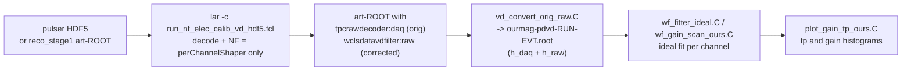
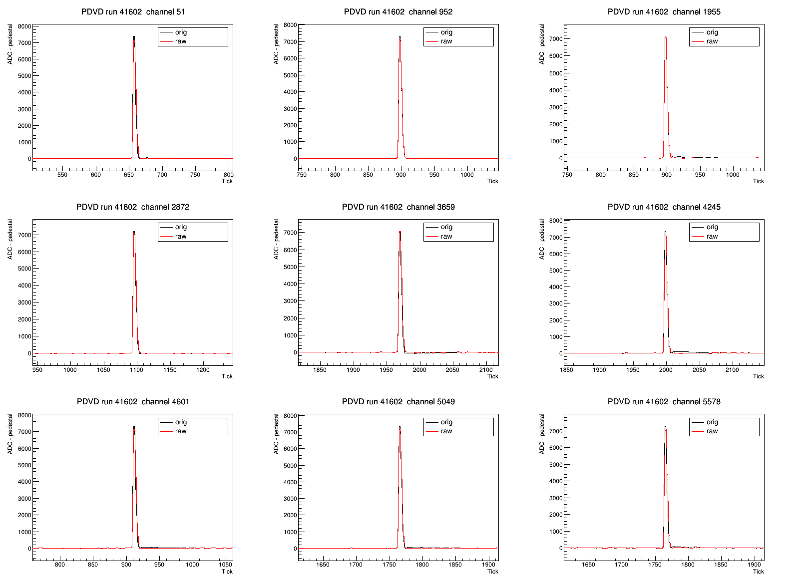
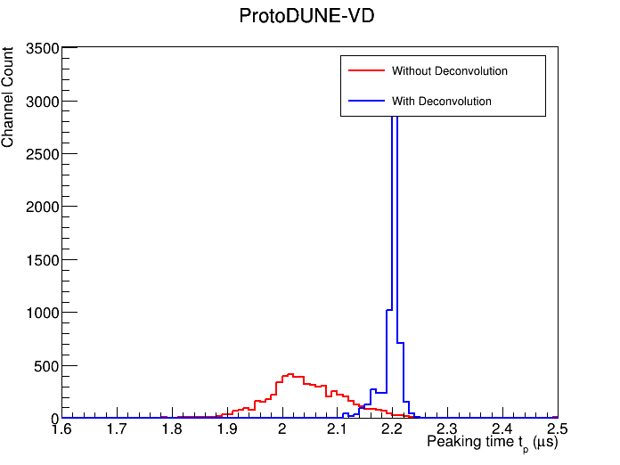
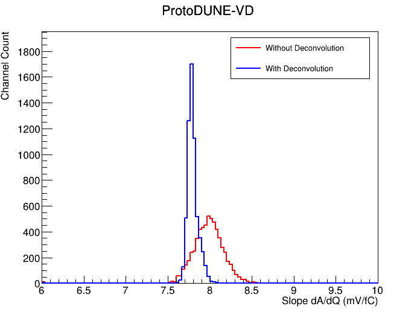
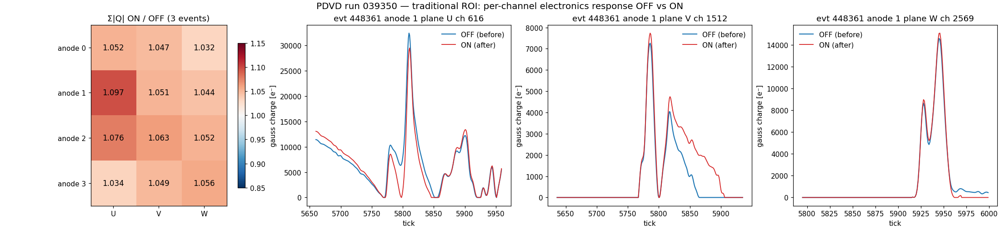
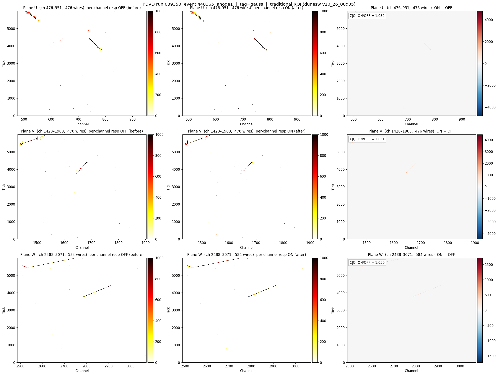

[Index](README.md) · [1 What is it](01_what_is_electronics_response.md) · [2 Tail](02_pole_zero_tail.md) · [3 Pulser data](03_calibration_data.md) · [4 Fitting](04_fitting_per_channel.md) · [5 Linearity](05_linearity_and_gain.md) · [6 In SP](06_correction_in_signal_processing.md) · **7 Validation** · [8 Scripts](08_script_index.md) · [9 LArSoft how-to](09_running_larsoft.md) · [10 First LArSoft run](10_simple_larsoft_rawdump.md)

# 7. Validation and running the full chain

The Python on pages 1–6 explains the method. In production the work is done by LArSoft + Wire-Cell jobs, which run inside the SL7 apptainer container with a dunesw release. [Page 9](09_running_larsoft.md) is a step-by-step guide to entering the container, setting up dunesw and customizing the fcl and jsonnet. There are two chains:

| chain | input | what it shows | scripts |
|---|---|---|---|
| **A. calibration check** | pulser runs | the corrected pulser waveforms really have the ideal shape | `script/calib_chain/` |
| **B. NF+SP ON/OFF** | physics runs | the effect on reconstructed charge | `script/sp_chain/` |

## A. Calibration check on pulser data

The noise filter is reduced to **only** `perChannelShaper` (all other filters off), so the output RawDigits are the raw waveforms after E_ideal/E_channel. A second step dumps them to a "magnify" ROOT file, and a third fits them.



Ingredients (originals at FNAL under `/exp/dune/data/users/xning/proto-dune-vd/`; copies of the scripts in `script/calib_chain/`):

| item | file |
|---|---|
| NF config (VD) | `wire-cell-cfg/pgrapher/experiment/protodunevd/nf_elec_calib.jsonnet` (NF with only `perChannelShaper`) and `wcls_nf_elec_calib.jsonnet` (bottom anodes only, native 512 ns, chooses `chresp_file`); the dunereco change is [DUNE/dunereco@0b6d6ae](https://github.com/DUNE/dunereco/commit/0b6d6ae6253c3606b4d65ba6766818423bd42b97) |
| fcl | `run_nf_elec_calib_vd_hdf5.fcl` (from HDF5; sets `ClockSpeedTPC: 1.953125` = 1/0.512 µs), `run_nf_elec_calib_vd.fcl` (from reco_stage1), `run_nf_elec_calib_hd.fcl` |
| drivers | `run_elec_calib.sh` (outside the container: wraps apptainer), `incontainer_elec_calib.sh`, `reprocess_vd_scan.sh` (all 9 scan runs) |
| ROOT macros | `vd_convert_orig_raw.C`, `vd_convert_artroot_raw.C`, `vd_orig_vs_raw_compare.C`, `wf_fitter_ideal.C`, `wf_gain_scan_ours.C`, `plot_gain_tp_ours.C`, `plot_charge_vs_a0_ours.C`, `peaking_time_from_artroot.C` |

Typical use (step by step in [`script/calib_chain/ELEC_CALIB_NOTE.md`](script/calib_chain/ELEC_CALIB_NOTE.md)):

```bash
cd $PROTO/elec_res                       # PROTO=/exp/dune/data/users/xning/proto-dune-vd
./run_elec_calib.sh --det vd --run 41602 --from-hdf5 --input /path/to/np02vd_raw_run041602_...hdf5
./reprocess_vd_scan.sh                   # all 9 runs -> output/scan/ourmag-*.root (~10 min)
# inside the container:
root -b -q 'wf_gain_scan_ours.C+("vd","daq")'
root -b -q 'wf_gain_scan_ours.C+("vd","raw")'
root -b -q 'plot_gain_tp_ours.C("vd")'
```

### Results (January 2026 scan, correction = `41603-no_avg_3`)



*Run 41602: original (black) and corrected (red) pulses for nine channels. The small tail after the peak (black) is removed.*

| peaking time | gain |
|---|---|
|  |  |

*Red: without the correction. Blue: with it. tp moves to the nominal 2.2 µs (2.047 ± 0.072 → 2.198 ± 0.020 µs), and the gain distribution narrows around 7.8 mV/fC ([page 5](05_linearity_and_gain.md)). Same histograms as slide 6 of the 1 July 2026 slides ([Sources](README.md#sources)).*

## B. NF+SP with the correction ON vs OFF on physics data

`script/sp_chain/` is the self-contained bundle described in [`script/sp_chain/NFSP_PCRESP_NOTE.md`](script/sp_chain/NFSP_PCRESP_NOTE.md), tested with dunesw v10_26_00d05. It runs four jobs: {traditional ROI, DNN-ROI} × {correction off, on}. It then flattens the `gauss` output and plots ON vs OFF.

```bash
mkdir work && cd work
../script/sp_chain/run_all.sh /path/to/np02vd_raw_run039252_1176_df-s03-d3_dw_0_20250830T054542.hdf5 3 039252
#   -> runs/{trad,dnn}_{off,on}/  and  plots/  (≈ 4 min trad, 6.5 min dnn, 3 events, CPU)
```

`run_nfsp.sh` builds the ON configuration as a full copy of the release `wire-cell-cfg` with the two edits from [page 6](06_correction_in_signal_processing.md). It puts `sp_chain/data/` (the 500 ns response file) on `WIRECELL_PATH`.

Check that the correction actually ran:

```bash
grep -c "applying ch-by-ch electronics response correction" runs/*/nfsp.log
#   expect  nevents x 4 anodes x 3 planes  in each ON log (36 for 3 events), 0 in OFF logs
```

### Results

Reconstructed (gauss) charge Σ|Q|, ON / OFF, for the bottom anodes. Run 039350, 3 events, v10_26_00d05 (from `elec_test/plots/summary.txt` of the share bundle):

| anode | trad U | trad V | trad W | dnn U | dnn V | dnn W |
|---|---|---|---|---|---|---|
| 0 | 1.052 | 1.047 | 1.032 | 1.042 | 1.034 | 1.032 |
| 1 | 1.097 | 1.051 | 1.044 | 1.072 | 1.053 | 1.044 |
| 2 | 1.076 | 1.063 | 1.052 | 1.068 | 1.050 | 1.052 |
| 3 | 1.034 | 1.049 | 1.056 | 1.069 | 1.046 | 1.056 |

Top anodes 4–7 are bit-identical ON vs OFF, as they must be. The correction **raises the bottom-drift charge by 3–10 %**. The size is consistent with the gain change alone: SP assumes 7.8 mV/fC, while the median fitted gain in the file is 8.14 mV/fC (8.14 / 7.8 = 1.044). The tail removal and track topology then add channel-dependent differences. Run 039252 in the NFSP note gives similar numbers (0.99–1.08).





*Left/middle: gauss charge OFF and ON, channel × tick. Right: ON − OFF. The difference follows the tracks: a few percent everywhere, no new structure.*

## Pitfalls collected from the logs

| symptom | cause | fix |
|---|---|---|
| a whole plane reconstructs as zero charge, no error | one channel with k4 = k6 in the response file → NaN response → NaN spreads through the wire FFT | `regen_chresp_tick.py --check`, then `--fix-pole` |
| `decon_2D_init: channel response size mismatch` | response grid (512 ns) ≠ SP tick (500 ns) | re-grid with `regen_chresp_tick.py --tick 500` |
| `no response for channel N` | file covers bottom channels only | gate `per_chan_resp` on `anode.data.ident < 4` |
| `no such file: protodunevd-params-channel-response-...` | file not on `WIRECELL_PATH` (found by basename) | put its directory on the path |
| edited jsonnet has no effect | overlay with only the edited files; siblings imported by relative path win | full copy of `wire-cell-cfg` |
| correction applied twice | `perChannelShaper` in NF **and** `per_chan_resp` in SP | use exactly one (SP in production) |
| calibration NF writes 0-sample RawDigits | `intraces='orig'` does not match the per-anode `orig<N>` tag after the fanout | `intraces='orig%d' % ident` (in `wcls_nf_elec_calib.jsonnet`) |
| `Failed to find instance "anode4"` | bottom-only run, top anodes referenced | build bottom anodes only |
| second of two parallel jobs dies with `SQLExecutionError` | both write `time.db`/`mem.db` in the same directory | one directory per job |
| on v10_26 the "trad" fcl runs DNN-ROI | `standard_reco_protodunevd_keepup.fcl` sets `wclsdatavd` to the DNN producer | set `@local::protodunevd_nfsp` and `use_resampler: "true"` explicitly (`sp_chain/fcl/run_vd_nfsp_trad.fcl`) |
| locally built toolkit fails in the container (`GLIBC_2.32 not found`) | host-built libraries in the SL7 container | use the release Wire-Cell; only the cfg is ours. Since v10_26 (Wire-Cell 0.37.1) the release also has `perChannelShaper`, which the older calibration chain built locally |
| fake 2.3× gain jump before/after | before and after taken from different magnify productions | build both from one job (`vd_convert_orig_raw.C`) |
| slopes ~920 "ADC/fC" | `response_legacy` A0 = 10 × peak | divide by 10, or use the true peak |

---
← [6. In SP](06_correction_in_signal_processing.md) · Next: [8. Script index →](08_script_index.md)
