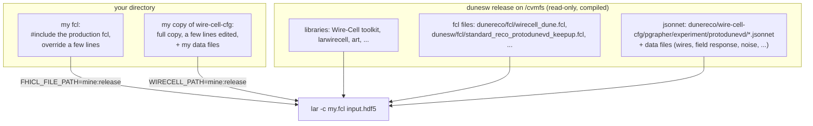

[Index](README.md) · [1 What is it](01_what_is_electronics_response.md) · [2 Tail](02_pole_zero_tail.md) · [3 Pulser data](03_calibration_data.md) · [4 Fitting](04_fitting_per_channel.md) · [5 Linearity](05_linearity_and_gain.md) · [6 In SP](06_correction_in_signal_processing.md) · [7 Validation](07_validation_and_running.md) · [8 Scripts](08_script_index.md) · **9 LArSoft how-to** · [10 First LArSoft run](10_simple_larsoft_rawdump.md)

> New to LArSoft? Start with [page 10](10_simple_larsoft_rawdump.md): the simplest job (decode + dump raw waveforms), typed line by line.

# 9. Running the LArSoft job: container, dunesw, your own jsonnet and fcl

This page is a hands-on guide to running Wire-Cell NF + SP through LArSoft with your own settings, for example with the per-channel electronics response switched on. Everything here was run on 2026-10-26 with **dunesw v10_26_00d05**. The example scripts are in [`script/larsoft_example/`](script/larsoft_example/), and the bigger ON/OFF bundle they borrow from is `../nfsp_share/` (also in `script/sp_chain/`).

## The key idea: change text files, not libraries

A dunesw release already contains everything compiled: the Wire-Cell toolkit (here v0.37.1), the LArSoft↔Wire-Cell glue (`larwirecell`), and the DUNE configuration (`dunereco`). For this work the release library already has every component we need:

```
$ nm -D .../wirecell/v0_37_1/.../lib/libWireCellSigProc.so | grep -o 'make_[A-Za-z]*_factory'
make_OmnibusSigProc_factory            # SP, with the per_chan_resp option (page 6)
make_ParamsPerChannelResponse_factory  # reads the response file
make_perChannelShaper_factory          # the NF-stage version (calibration check, page 7)
```

So **nothing needs to be compiled**. A job is controlled by two layers of plain text, and each layer is looked up along a search path. Put your own directory first on a path and your file wins:



| layer | what it sets | search path | how to customize |
|---|---|---|---|
| **fcl** (art/LArSoft) | which modules run, input/output, and which jsonnet file Wire-Cell loads with which parameters | `FHICL_FILE_PATH` | a small fcl that `#include`s the production one and overrides lines |
| **jsonnet** (Wire-Cell) | the Wire-Cell graph: NF, SP, response files, filters | `WIRECELL_PATH` | a full copy of `wire-cell-cfg` with your edits, first on the path |

A locally built toolkit is not needed. In fact a toolkit built on the host (Debian, glibc 2.36) **cannot** be loaded in the SL7 container: it fails with `GLIBC_2.32 not found`. Use the release libraries.

## Step 1: enter the SL7 container

dunesw is built for Scientific Linux 7, so on a modern host (wcgpu1 is Debian 12; FNAL gpvms are AlmaLinux 9) it runs inside the Fermilab SL7 image from `/cvmfs`:

```bash
APP=/cvmfs/oasis.opensciencegrid.org/mis/apptainer/current/bin/apptainer   # or "apptainer" if installed
IMAGE=/cvmfs/singularity.opensciencegrid.org/fermilab/fnal-dev-sl7:latest
$APP shell --no-home -H $HOME -B /cvmfs,/nfs/data/1/xning --ipc --pid $IMAGE
```

- `-B` lists every directory you need to see inside (bind mounts). **Your data and your work area must be in this list.** Anything else does not exist inside the container.
- `--no-home -H $HOME` keeps the normal home directory without mounting extra host paths.
- A harmless `WARNING: group: unknown groupid ...` may appear.
- On an FNAL gpvm the usual one-liner is the same command with `-B /cvmfs,/exp,/nashome,/opt,...`. Many people keep it in a `container.sh`.

Or use the helper, which mounts `/cvmfs`, the current directory and every directory you name:

```bash
script/larsoft_example/enter_sl7.sh /path/to/data /path/to/work
```

## Step 2: set up dunesw

Inside the container:

```bash
export TMPDIR=/tmp            # UPS needs a writable TMPDIR; the host one is usually not mounted
source /cvmfs/dune.opensciencegrid.org/products/dune/setup_dune.sh
setup dunesw v10_26_00d05 -q e26:prof
```

or `source script/larsoft_example/setup_dunesw.sh [version] [qualifier]`, which does the same and prints where things are:

```
dunesw v10_26_00d05 -q e26:prof
  lar          : /cvmfs/larsoft.opensciencegrid.org/products/art/v3_14_04/slf7.x86_64.e26.prof/bin/lar
  wire-cell    : /cvmfs/larsoft.opensciencegrid.org/products/wirecell/v0_37_1/Linux64bit+3.10-2.17-e26-prof/bin/wire-cell
  DUNERECO_DIR : /cvmfs/dune.opensciencegrid.org/products/dune/dunereco/v10_26_00d05
  release cfg  : /cvmfs/dune.opensciencegrid.org/products/dune/dunereco/v10_26_00d05/wire-cell-cfg   (first on WIRECELL_PATH)
```

After setup:

- `WIRECELL_PATH` = `$DUNERECO_DIR/wire-cell-cfg` : the toolkit's `share/wirecell` : `dune_pardata/.../WireCellData`.
- `FHICL_FILE_PATH` includes `$DUNERECO_DIR/fcl` (with `wirecell_dune.fcl`) and the dunesw `fcl` directory (with `standard_reco_protodunevd_keepup.fcl`).
- The UPS setup scripts are not `set -u` clean. In a script, wrap them in `set +u … set -u`.

## Step 3: know what production runs

The PDVD production ("keepup") job is `standard_reco_protodunevd_keepup.fcl`. Its Wire-Cell module is the producer `wclsdatavd`, whose settings come from `wirecell_dune.fcl`. In v10_26:

```
physics.producers.wclsdatavd: @local::protodunevd_nfsp_dnnroi     # NF + SP + DNN-ROI + L1SP
```

and the traditional-ROI version is defined next to it in `wirecell_dune.fcl`:

```
protodunevd_nfsp : {
   module_type : WireCellToolkit
   wcls_main: {
      tool_type: WCLS
      apps: ["Pgrapher"]
      plugins: ["WireCellGen", "WireCellSigProc", "WireCellRoot", "WireCellPgraph", "WireCellLarsoft"]
      inputers: ["wclsRawFrameSource"]
      outputers: ["wclsFrameSaver:spsaver"]
      configs: ["pgrapher/experiment/protodunevd/wcls-nf-sp.jsonnet"]   # <- top-level jsonnet, found on WIRECELL_PATH
      params : {                                                         # <- jsonnet std.extVar(...) as STRINGS
         raw_input_label: "tpcrawdecoder:daq"
         reality: "data"
         epoch: "after"
         signal_output_form: "sparse"
         use_magnify: "false"
         use_resampler: "false"
      }
      structs: {                                                         # <- jsonnet std.extVar(...) as CODE (numbers, booleans)
        Nbit: @local::Nbit_standard
        elecGain: 14
        use_dnnroi: false
      }
   }
}
```

This is how fcl reaches Wire-Cell: `configs` names the top-level jsonnet, and every entry of `params` and `structs` becomes a jsonnet external variable (`std.extVar('use_resampler')` in `wcls-nf-sp.jsonnet`). To change one of these, override it in fcl. You do not need to touch the jsonnet for that.

Useful ways to look:

```bash
lar -c my.fcl --debug-config expanded.fcl      # the fully expanded fcl, after all includes/overrides
ls $DUNERECO_DIR/wire-cell-cfg/pgrapher/experiment/protodunevd/
lar -c eventdump.fcl -s output.root -n 1       # list the products in an output file
```

## Step 4: customize the fcl

Do not copy the production fcl. `#include` it and override only what you need. This is [`script/larsoft_example/my_nfsp.fcl`](script/larsoft_example/my_nfsp.fcl):

```
#include "standard_reco_protodunevd_keepup.fcl"

process_name: mynfsp

# keepup's wclsdatavd is the DNN-ROI producer in v10_26: choose the traditional one
physics.producers.wclsdatavd: @local::protodunevd_nfsp
# bottom anodes are sampled at 512 ns; resample to 500 ns (the response file is on 500 ns)
physics.producers.wclsdatavd.wcls_main.params.use_resampler: "true"

# run only: decoders + Wire-Cell NF/SP (no hits, pandora, ...)
physics.produce:       [ rns, tpcrawdecoder, triggerrawdecoder, wclsdatavd ]
physics.trigger_paths: [ produce ]
physics.end_paths:     [ output ]

outputs.out1.fileName:       "%ifb_mynfsp.root"
outputs.out1.outputCommands: [ "keep *", "drop raw::RawDigit*_*_*_*" ]
services.TFileService.fileName: "%ifb_mynfsp_hist.root"
```

Put its directory first on the fcl path and run it:

```bash
export FHICL_FILE_PATH=/path/to/script/larsoft_example:$FHICL_FILE_PATH
lar -n 1 -c my_nfsp.fcl /path/to/np02vd_raw_run039252_1176_df-s03-d3_dw_0_20250830T054542.hdf5
```

The output has the deconvolved signals as `recob::Wire` products `wclsdatavd:gauss:mynfsp` and `wclsdatavd:wiener:mynfsp` (12288 channels each). They are stored as charge × 0.005, so divide by 0.005 to get electrons.

More fcl overrides that are often needed:

| want | add to your fcl |
|---|---|
| DNN-ROI (the keepup default) on a **bottom-only** file | `physics.producers.wclsdatavd.wcls_main.params.active_anodes: "0,1,2,3"` (see [`my_nfsp_dnn_bottom.fcl`](script/larsoft_example/my_nfsp_dnn_bottom.fcl)); otherwise `L1SPFilterPD: unexpected input: 0 ADC traces` |
| dense instead of sparse output | `physics.producers.wclsdatavd.wcls_main.params.signal_output_form: "dense"` |
| a different top-level jsonnet | `physics.producers.wclsdatavd.wcls_main.configs: [ "pgrapher/experiment/protodunevd/my-top.jsonnet" ]` |
| a different module in the Wire-Cell slot, e.g. NF only | `physics.producers.wclsdatavd: @local::protodunevd_nf` + `configs` + `outputers` (see `script/calib_chain/run_nf_elec_calib_vd_hdf5.fcl`) |
| keep the raw digits | drop the `"drop raw::RawDigit*_*_*_*"` entry |
| more/less Wire-Cell logging | `physics.producers.wclsdatavd.wcls_main.loglevels: ["info"]` |

Release traps to remember (v10_26):

- An fcl that only trims the path of the keepup job runs **DNN-ROI**, not traditional ROI, because keepup's `wclsdatavd` is the DNN producer. Set `@local::protodunevd_nfsp` explicitly.
- The stock `protodunevd_nfsp` has `use_resampler: "false"`. With the per-channel response on 500 ns, SP then throws `channel response size mismatch`. Set `"true"`.

## Step 5: customize the jsonnet

The jsonnet tells Wire-Cell *what to build*. To switch on the per-channel electronics response (page 6) you change two lines in `params.jsonnet` and `sp.jsonnet` and add the response file.

**Copy the whole `wire-cell-cfg`, not only the files you edit.** The release jsonnets import their neighbours by relative path (`import 'params.jsonnet'`), and jsonnet resolves that from the importing file's own directory *before* looking at `WIRECELL_PATH`. A directory holding only your two edited files would be silently ignored.

```bash
cp -r $DUNERECO_DIR/wire-cell-cfg my-wire-cell-cfg
chmod -R u+w my-wire-cell-cfg
P=my-wire-cell-cfg/pgrapher/experiment/protodunevd
# 1. params.jsonnet: name the response file  (chresp: null -> the file)
sed -i 's|^        chresp: null,$|        chresp: "protodunevd-params-channel-response-41603-no_avg_3-500ns.json.bz2",|' $P/params.jsonnet
# 2. sp.jsonnet: apply it on the bottom anodes only (the file covers channels 0-6143)
sed -i "s|^      per_chan_resp: pc.name,\$|      per_chan_resp: if anode.data.ident < 4 then pc.name else '',|" $P/sp.jsonnet
# 3. the data file goes at the top of the copy (files are found by basename on WIRECELL_PATH)
cp /path/to/protodunevd-params-channel-response-41603-no_avg_3-500ns.json.bz2 my-wire-cell-cfg/
# 4. put the copy first
export WIRECELL_PATH=$PWD/my-wire-cell-cfg:$WIRECELL_PATH
diff -r $DUNERECO_DIR/wire-cell-cfg my-wire-cell-cfg      # shows exactly your edits
```

[`script/larsoft_example/make_cfg_copy.sh DEST [RESPONSE]`](script/larsoft_example/make_cfg_copy.sh) does steps 1–3. It stops if the two lines are not found exactly once, which means a newer release changed them and you must edit by hand. The diff it prints for v10_26_00d05:

```
202c202
<         chresp: null,
---
>         chresp: "protodunevd-params-channel-response-41603-no_avg_3-500ns.json.bz2",
119c119
<       per_chan_resp: pc.name,
---
>       per_chan_resp: if anode.data.ident < 4 then pc.name else '',
Only in my-wire-cell-cfg: protodunevd-params-channel-response-41603-no_avg_3-500ns.json.bz2
```

To switch the correction **off** again, take your copy off `WIRECELL_PATH`. The same fcl and the same libraries then run the release configuration.

Rules of thumb for jsonnet edits:

- Edit **your copy** of the release you run. Copies from another release can refer to files that release does not have, and can miss newer parameters. For example, a v10_21 `params.jsonnet` refers to `...wires-larsoft-v7-uvwfit.json.bz2`, which v10_26 does not ship.
- New data files (response files, wire files, ...) go **at the top** of your copy or in any directory on `WIRECELL_PATH`. They are referred to by bare filename.
- New jsonnet files (e.g. the calibration `nf_elec_calib.jsonnet` / `wcls_nf_elec_calib.jsonnet` of [page 7](07_validation_and_running.md)) go next to the files they import, and the fcl selects them through `configs`.
- The release has no `wcsonnet` binary. Check a configuration by running a short job (`lar -n 1`) and reading the log.

## Step 6: run and check

Everything above in one command, from the host. It enters the container, sets up dunesw, builds `my-wire-cell-cfg` and runs `my_nfsp.fcl`:

```bash
script/larsoft_example/run_example.sh /path/to/np02vd_raw_run039252_1176_df-s03-d3_dw_0_20250830T054542.hdf5 \
        data/protodunevd-params-channel-response-41603-no_avg_3-500ns.json.bz2  1  ./larsoft_example_run
```

Output of the test run (1 event, about 1.5 min):

```
lar exit 0;  correction applied 12 times (expect NEVTS x 4 anodes x 3 planes)
protodunevd-params-channel-response-41603-no_avg_3-500ns.json.bz2
```

Checks worth doing after every customized job:

```bash
grep -c "applying ch-by-ch electronics response correction" lar.log   # = nevents x 4 x 3 when ON, 0 when OFF
grep -o "protodunevd-params-channel-response[^ \"']*" lar.log | sort -u  # the file actually loaded
grep "configs" -A2 my_nfsp_expanded.fcl                                 # the jsonnet actually used
lar -c eventdump.fcl -s *_mynfsp.root -n 1                                # products written
```

- Run **each job in its own directory.** art writes `time.db` and `mem.db` into the current directory, and two jobs sharing one directory corrupt each other (`SQLExecutionError` at EndJob).
- With the DNN arm, the log shows `TorchService` / `DNNROI` lines; inference runs on the CPU.

## Bigger example: the ON/OFF bundle

`../nfsp_share/` (copied as [`script/sp_chain/`](script/sp_chain/)) is the same recipe made into a tool for colleagues. Its `env.sh` holds `enter_container` and `setup_dunesw` (steps 1–2), and `run_nfsp.sh ARM on|off INPUT NEVTS` does steps 4–6 for {traditional, DNN} × {off, on}. `run_all.sh` runs all four jobs and makes the comparison plots of [page 7](07_validation_and_running.md):

```bash
mkdir work && cd work
../script/sp_chain/run_all.sh /path/to/np02vd_raw_run039252_...hdf5 3 039252
```

Environment knobs: `DUNESW_VER`, `DUNESW_QUAL`, `SL7_IMAGE`, `APPTAINER`, `CONTAINER_HOME`, `EXTRA_BINDS`, `OUTDIR`, `ACTIVE_ANODES` (see [`../NFSP_PCRESP_NOTE.md`](../NFSP_PCRESP_NOTE.md)). To move to a newer dunesw, set `DUNESW_VER`. The scripts copy *that* release's `wire-cell-cfg` and stop if the two edited lines changed.

---
← [8. Script index](08_script_index.md) · Next: [10. A first LArSoft run, line by line →](10_simple_larsoft_rawdump.md)
