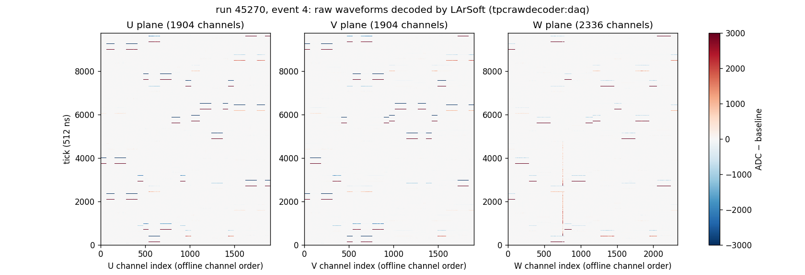
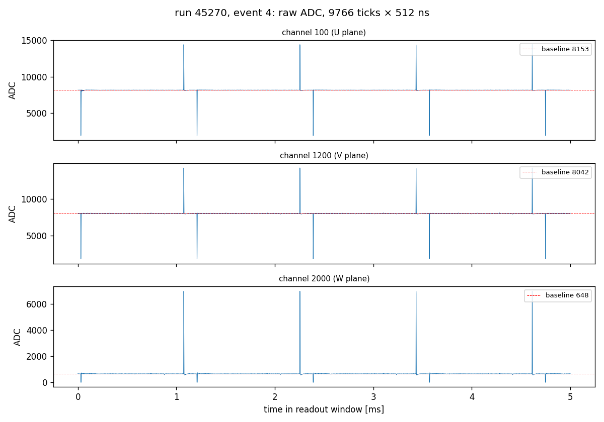
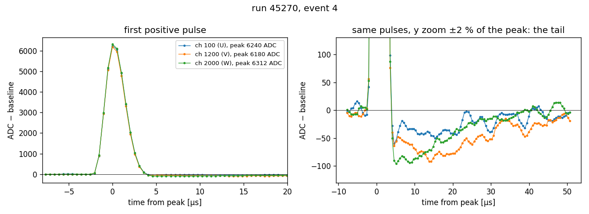
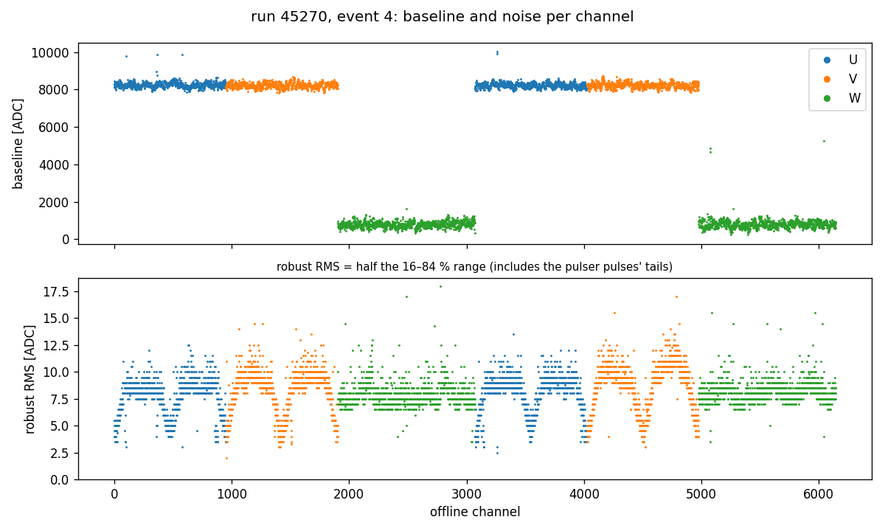

[Index](README.md) · [1 What is it](01_what_is_electronics_response.md) · [2 Tail](02_pole_zero_tail.md) · [3 Pulser data](03_calibration_data.md) · [4 Fitting](04_fitting_per_channel.md) · [5 Linearity](05_linearity_and_gain.md) · [6 In SP](06_correction_in_signal_processing.md) · [7 Validation](07_validation_and_running.md) · [8 Scripts](08_script_index.md) · [9 LArSoft how-to](09_running_larsoft.md) · **10 First LArSoft run**

# 10. A first LArSoft run, line by line: dump the raw waveforms

This page is the simplest possible LArSoft job. It reads the raw DAQ file (HDF5), lets LArSoft decode it into one waveform per channel (`raw::RawDigit`), and then plots the waveforms. There is no noise filtering and no signal processing. Type the commands one at a time. Each step says what you should see.

The files are in [`script/larsoft_rawdump/`](script/larsoft_rawdump/):

| file | where it runs | what it does |
|---|---|---|
| [`dump_raw_pdvd.fcl`](script/larsoft_rawdump/dump_raw_pdvd.fcl) | container, `lar` | HDF5 → decoder → art-ROOT file holding only the RawDigits |
| [`rawdigit_to_tree.C`](script/larsoft_rawdump/rawdigit_to_tree.C) | container, `root` | art-ROOT → a plain ROOT tree (`channel`, `pedestal`, `adc[]`) that any ROOT or python can read |
| [`plot_raw_waveforms.py`](script/larsoft_rawdump/plot_raw_waveforms.py) | host, `python3` | the plots below |

Example input: the pulser run of [page 3](03_calibration_data.md),
`/nfs/data/1/xning/wirecell-working/elec_response/np02vd_raw_run045270_0000_df-s04-d0_dw_0_20260929T175649.hdf5`.

## Step 0: pick a work directory (on the host)

```bash
mkdir -p /nfs/data/1/$USER/rawdump_test
cd /nfs/data/1/$USER/rawdump_test
cp /nfs/data/1/xning/wirecell-working/elec_response/elec_resp_tutorial/script/larsoft_rawdump/* .
```

`lar` writes its output in the current directory, so start in a directory you own.

## Step 1: enter the SL7 container

dunesw is built for Scientific Linux 7. This machine runs a newer Linux, so LArSoft only runs inside an SL7 container (a self-contained SL7 system that sees your files):

```bash
/cvmfs/oasis.opensciencegrid.org/mis/apptainer/current/bin/apptainer shell --shell=/bin/bash \
    --no-home -H /nfs/data/1/$USER/home \
    -B /cvmfs,/nfs,/opt,/etc/hostname,/etc/hosts,/etc/krb5.conf \
    --ipc --pid /cvmfs/singularity.opensciencegrid.org/fermilab/fnal-dev-sl7:latest
```

What the options mean:

| option | meaning |
|---|---|
| `--shell=/bin/bash` | the shell you get inside |
| `--no-home -H /nfs/data/1/$USER/home` | do not mount the real home; use this directory as `$HOME` inside, so host login files (`.bashrc` with host-only setups) do not leak in |
| `-B /cvmfs,/nfs,...` | directories made visible inside ("bind mounts"). `/cvmfs` has the software and `/nfs` has your data and work area. **A directory not listed here does not exist inside the container.** Add your own with `,/my/dir` |
| `--ipc --pid` | private process space, so the job is cleaned up when you leave |
| last argument | the SL7 image, served from `/cvmfs` |

The prompt changes to `Apptainer>`. You are still in the same directory (it is under `/nfs`). A warning `group: unknown groupid ...` is harmless. Type `exit` to leave.

## Step 2: set up dunesw (inside the container)

```bash
export TMPDIR=/tmp      # UPS needs a writable temp directory that exists inside the container
source /cvmfs/dune.opensciencegrid.org/products/dune/setup_dune.sh
setup dunesw v10_21_02d00 -q e26:prof
```

- `setup_dune.sh` turns on UPS, the Fermilab package manager (it gives you the `setup` command).
- `setup dunesw VERSION -q QUALIFIER` sets up the release and everything it needs: `lar`, `root`, the decoders, and the fcl and data search paths. `e26:prof` means compiler gcc 12 (e26), optimized build (prof). The available versions are listed by `ls /cvmfs/dune.opensciencegrid.org/products/dune/dunesw/`. Any recent version works for this page; [page 9](09_running_larsoft.md) uses v10_26_00d05.

Check:

```bash
which lar                       # .../art/.../bin/lar
echo $FHICL_FILE_PATH | tr : '\n' | head -3   # where lar looks for #include'd fcl files
```

## Step 3: decode the HDF5 file with `lar`

```bash
lar -c dump_raw_pdvd.fcl -n 1 \
    -s /nfs/data/1/xning/wirecell-working/elec_response/np02vd_raw_run045270_0000_df-s04-d0_dw_0_20260929T175649.hdf5
```

| option | meaning |
|---|---|
| `-c FILE.fcl` | the job configuration |
| `-n 1` | process 1 event (a "trigger record"); drop it for all 23 |
| `-s FILE` | the input file |

It takes about 30 s and ends with `Art has completed and will exit with status 0.` You get two files:

```
np02vd_raw_run045270_0000_df-s04-d0_dw_0_20260929T175649_rawdump.root        50 MB   the RawDigits (art-ROOT)
np02vd_raw_run045270_0000_df-s04-d0_dw_0_20260929T175649_rawdump_hist.root   small   decoder status tree
```

### What is in the fcl

The whole job ([`dump_raw_pdvd.fcl`](script/larsoft_rawdump/dump_raw_pdvd.fcl)) has four parts:

```
#include "HDF5RawInput3.fcl"          # defines  hdf5rawinput3           (the HDF5 reader)
#include "PDVDTPCReader.fcl"          # defines  PDVDTPCReaderDefaults   (the PDVD TPC decoder)

services: {                           # helpers that modules use
  HDF5RawFile3Service:  {}                                   # opens the HDF5 file
  TPCChannelMapService: { FileName: "PD2VDTPCChannelMap_v2.txt" }   # (crate, slot, stream, ch) -> offline channel
  TFileService:         { fileName: "%ifb_rawdump_hist.root" }       # small histogram/tree output
  TimeTracker: {}
}
source: @local::hdf5rawinput3         # where events come from (the -s file)

physics: {
  producers: { tpcrawdecoder: @local::PDVDTPCReaderDefaults }   # WIBEth frames -> RawDigit per channel
  produce: [ tpcrawdecoder ]          # the modules to run, in order
  output:  [ out1 ]
  trigger_paths: [ produce ]
  end_paths:     [ output ]
}
outputs.out1: {
  module_type: RootOutput
  fileName: "%ifb_rawdump.root"       # %ifb = input file name without extension
  outputCommands: [ "drop *", "keep raw::RawDigits_tpcrawdecoder_*_*" ]   # keep only the waveforms
}
```

- `@local::name` copies a block defined in an included fcl. You only write what differs.
- The included files come from the release (found via `$FHICL_FILE_PATH`). To read one: `find ${FHICL_FILE_PATH//:/ } -name PDVDTPCReader.fcl 2>/dev/null | head -1`.
- The product is named `module:instance:process`, here `tpcrawdecoder:daq:rawdump` (`OutputInstance: "daq"` in the decoder defaults, and `process_name: rawdump`).
- This fcl is a trimmed copy of `run_pdvd_wibeth_tpc_decoder.fcl` from duneprototypes. The full production chain ([page 9](09_running_larsoft.md)) adds the trigger decoder, the resampler and Wire-Cell NF/SP to the same `produce` list.

To list the products in the output file:

```bash
lar -c eventdump.fcl -n 1 -s np02vd_raw_run045270_0000_df-s04-d0_dw_0_20260929T175649_rawdump.root
#  rawdump..... | tpcrawdecoder | daq.... | std::vector<raw::RawDigit> | 6144
```

## Step 4a: make a plain ROOT tree (inside the container)

An art-ROOT file needs the LArSoft libraries to be read. A small ROOT macro (using *gallery*, the library that reads art files without running `lar`) copies the waveforms into a plain tree:

```bash
root -l -b -q 'rawdigit_to_tree.C("np02vd_raw_run045270_0000_df-s04-d0_dw_0_20260929T175649_rawdump.root", "rawdigits_run45270.root")'
```

Output:

```
run 45270 event 4: 6144 RawDigits, 9766 ticks
wrote 6144 channel waveforms to rawdigits_run45270.root
```

Tree `raw`, one entry per channel: `run`, `event`, `channel` (offline channel number), `pedestal` (the decoder's estimate), `adc` (vector of raw ADC counts, **not** pedestal-subtracted). Quick look in ROOT:

```bash
root -l rawdigits_run45270.root
root [1] raw->Draw("adc:Iteration$", "channel==100", "l")     // one waveform
root [2] raw->Draw("pedestal:channel")                         // pedestals
```

Then `exit` the container.

## Step 4b: plot (on the host)

```bash
python3 plot_raw_waveforms.py rawdigits_run45270.root --outdir plots
#   --channels U V W   pick the three example channels (default 100 1200 2000)
#   --event N          pick an event if the file has several
```

It needs `numpy`, `matplotlib` and `uproot`, all on the host python. The plane of each channel comes from the channel-map file on `/cvmfs`. It prints:

```
run 45270 event 4: 6144 channels 0..6143, 9766 ticks
  U: 1904 channels, median baseline 8236 ADC, median max(ADC - baseline) 6329
  V: 1904 channels, median baseline 8232 ADC, median max(ADC - baseline) 6321
  W: 2336 channels, median baseline 786 ADC, median max(ADC - baseline) 6293
```



*ADC − baseline for every channel, per plane. Each short horizontal stripe is one group of channels pulsed at the same time: red is the positive pulse, blue the negative one ([page 3](03_calibration_data.md) explains the pulse pattern). The W-plane vertical line near index 750 is one noisy channel.*



*Full 5 ms readout of one channel per plane. The induction planes (U, V) sit at about 8200 ADC, half way up the 14-bit range, because their signals are bipolar. The collection plane (W) sits at about 700 ADC, so its negative pulses hit 0 and are clipped.*



*Left: the first positive pulse of the same three channels, about 6300 ADC high. Right: the same pulses zoomed to ±2 % of the peak. The waveform drops below the baseline after the pulse and recovers over about 40 µs. This is the tail of [page 2](02_pole_zero_tail.md), and it is different for each channel.*



*Baseline and noise of every channel. Two CRPs (channels 0–3071 and 3072–6143), each with U, V, W blocks. The noise (robust RMS) of the induction planes rises and falls across each block, following the strip length.*

## Check: LArSoft and the python decoder agree exactly

The tutorial's own decoder [`script/pdvd_hdf5_decode.py`](script/pdvd_hdf5_decode.py) (no LArSoft) reads the same trigger record (`TriggerRecord00004`) as 6144 × 9792 samples. The LArSoft RawDigits are **bit-for-bit identical** to it from tick 24 on: the LArSoft decoder drops the first 24 samples of the record, which leaves 9766.

## The same thing in one script

Once the steps make sense, you can run them from the host without an interactive shell, using `apptainer exec` instead of `shell`:

```bash
APP=/cvmfs/oasis.opensciencegrid.org/mis/apptainer/current/bin/apptainer
IMG=/cvmfs/singularity.opensciencegrid.org/fermilab/fnal-dev-sl7:latest
H5=/nfs/data/1/xning/wirecell-working/elec_response/np02vd_raw_run045270_0000_df-s04-d0_dw_0_20260929T175649.hdf5
$APP exec --no-home -H /nfs/data/1/$USER/home -B /cvmfs,/nfs --ipc --pid $IMG /bin/bash -c "
  cd $PWD
  export TMPDIR=/tmp
  source /cvmfs/dune.opensciencegrid.org/products/dune/setup_dune.sh
  setup dunesw v10_21_02d00 -q e26:prof
  lar -c dump_raw_pdvd.fcl -n 1 -s $H5
  root -l -b -q 'rawdigit_to_tree.C(\"$(basename $H5 .hdf5)_rawdump.root\", \"rawdigits.root\")'
"
python3 plot_raw_waveforms.py rawdigits.root --outdir plots
```

## Where to go from here

- Process more events: drop `-n 1`. The tree then has one block of 6144 entries per event; plot one with `--event N`.
- Other PDVD raw files work the same way. A top-drift (TDE) file decodes with a different module and is not covered here.
- To add noise filtering and signal processing, and to change the Wire-Cell configuration, continue with [page 9](09_running_larsoft.md).

---
← [9. Running the LArSoft job](09_running_larsoft.md) · [Index](README.md)
