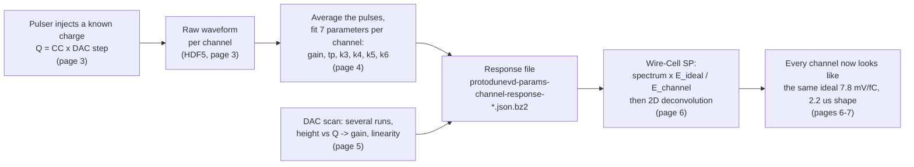

# Electronics response tutorial: ProtoDUNE-VD bottom drift (BDE)

This tutorial starts from the beginning: what the "electronics response" of a wire channel is. It then covers how the cold electronics measure it with their built-in pulser, how one response per channel is fitted, and how Wire-Cell signal processing (SP) uses the result. Every page links the scripts that made its plots, so you can rerun them.

Most plots come from one real calibration (pulser) file:
`np02vd_raw_run045270_0000_df-s04-d0_dw_0_20260929T175649.hdf5` (run 45270, 29 Sep 2026, bottom drift only).
The plots on gain and linearity use the earlier 9-run pulser scan (runs 41573–41603, Jan 2026), because a single run cannot show linearity.

## Pages

| # | page | what you learn |
|---|------|----------------|
| 1 | [What is the electronics response?](01_what_is_electronics_response.md) | signal chain, gain, peaking time, the ideal shape, units |
| 2 | [The tail: imperfect pole-zero cancellation](02_pole_zero_tail.md) | why real channels differ from the ideal shape, the k3..k6 parameters |
| 3 | [Calibration data from the cold-electronics pulser](03_calibration_data.md) | how the pulser injects a known charge; what raw pulser data look like |
| 4 | [Fitting one response per channel](04_fitting_per_channel.md) | averaging pulses, the 3- and 7-parameter fits, the response file format |
| 5 | [Gain and linearity from a DAC scan](05_linearity_and_gain.md) | pulse height vs injected charge, gain in mV/fC, ADC headroom |
| 6 | [Using the result in signal processing](06_correction_in_signal_processing.md) | the E_ideal/E_channel swap, where it lives in the code, a demonstration on real data |
| 7 | [Validation and running the full chain](07_validation_and_running.md) | the LArSoft/Wire-Cell jobs, before/after results, known pitfalls |
| 8 | [Script index](08_script_index.md) | every script in `script/`, with inputs and outputs |
| 9 | [Running the LArSoft job](09_running_larsoft.md) | enter the SL7 container, set up dunesw, override the fcl, copy and edit the Wire-Cell jsonnet, run and check |
| 10 | [A first LArSoft run, line by line](10_simple_larsoft_rawdump.md) | the simplest job: decode the raw HDF5 with `lar`, dump the waveforms to a plain tree, plot them |

## The whole story in one picture



## Setting up the environment

[`AGENT_ENV_SETUP.md`](AGENT_ENV_SETUP.md) lists everything the scripts need and gives three recipes: a shared spack view and a plain python venv (both tested from a clean shell), and your own spack (untested). Each recipe ends with an `.envrc`, so the environment turns on whenever you `cd` into the folder (direnv). It is written so you can hand it to your AI agent as-is. Check a setup with `env/check_env.sh`.

## Quick start: remake every plot

```bash
cd script
./make_all_plots.sh /path/to/np02vd_raw_run045270_0000_df-s04-d0_dw_0_20260929T175649.hdf5 \
                    ../data/protodunevd-params-channel-response-41603-no_avg_3.json.bz2
```

This needs `python3` with `numpy`, `scipy`, `matplotlib` and `h5py`, plus `/cvmfs` for the PDVD channel map. It takes about 5 minutes, and no LArSoft is required. The LArSoft/Wire-Cell jobs run inside the SL7 container: [page 9](09_running_larsoft.md) is the how-to and [page 7](07_validation_and_running.md) has the results.

## Folder layout

```
elec_resp_tutorial/
  README.md, 01_...md ... 10_...md    the pages
  plots/                              every figure used by the pages (made by script/)
  plots/previous/                     figures re-used from earlier work (slides, share bundle)
  data/                               small inputs/outputs: averaged pulses, fit results,
                                      9-run gain-scan tables, the 41603 response file (512 ns and 500 ns)
  script/                             the tutorial's python scripts (p1_... p6_..., helpers)
  script/calib_chain/                 LArSoft/ROOT calibration chain (FNAL paths inside, see page 7)
  script/sp_chain/                    NF+SP ON/OFF bundle (self-contained, see page 7)
  script/larsoft_example/             minimal container + dunesw + custom fcl/jsonnet example (page 9)
  script/larsoft_rawdump/             raw-waveform dump: fcl, gallery macro, plot script (page 10)
  AGENT_ENV_SETUP.md, env/            environment recipes, .envrc templates, requirements.txt, check_env.sh
```

## Words used throughout

| word | meaning |
|------|---------|
| BDE | Bottom Drift Electronics: the PDVD bottom readout. Same chips as ProtoDUNE-HD: LArASIC → ColdADC → COLDATA on a front-end board (FEMB), read by a WIB |
| LArASIC | the 16-channel cold front-end chip: a charge amplifier followed by a shaping filter |
| ColdADC | 14-bit ADC, one sample every 512 ns ("tick") |
| fC | femtocoulomb. 1 fC = 6241.5 electrons |
| gain | height of the output for 1 fC of input charge, in mV/fC |
| peaking time, tp | the time scale of the shaping filter (settings 0.5 / 1 / 2 / 3 µs) |
| response function | the output waveform for a very short input current pulse carrying 1 fC |
| pole, zero | the frequencies where a filter's transfer function blows up (pole) or vanishes (zero). A pole sets a decay time; a zero placed exactly on a pole cancels it |
| DAC | the pulser's digital setting; each DAC step injects 2.651 fC (at 7.8 mV/fC) |
| NF, SP | noise filtering and signal processing, both in Wire-Cell |
| deconvolution | dividing out the known detector response (field × electronics) in frequency space to recover the original charge |
| response file | `protodunevd-params-channel-response-<run>-no_avg_3.json.bz2`, 7 fitted numbers per channel |

## Sources

- Slides (not in this repository; ask the authors): 1 July 2026 talk on the per-channel response calibration (X. Ning, K. Tellez Giron Flores), and "Analytical form of LArASIC electronics response with imperfect pole-zero cancellation" (X. Qian).
- Notes: [`script/calib_chain/ELEC_CALIB_NOTE.md`](script/calib_chain/ELEC_CALIB_NOTE.md) (measuring the response, FNAL paths) and [`script/sp_chain/NFSP_PCRESP_NOTE.md`](script/sp_chain/NFSP_PCRESP_NOTE.md) (using it in NF+SP).
- Papers: MicroBooNE noise paper [arXiv:1705.07341](https://arxiv.org/abs/1705.07341) (ideal response, eq. 3.1–3.2); MicroBooNE SP paper II [arXiv:1804.02583](https://arxiv.org/abs/1804.02583) (per-channel response correction).
- Fitted response files (K. Tellez Giron Flores): `/exp/dune/data/users/ktellez/wf_correction/wc-params/`.
