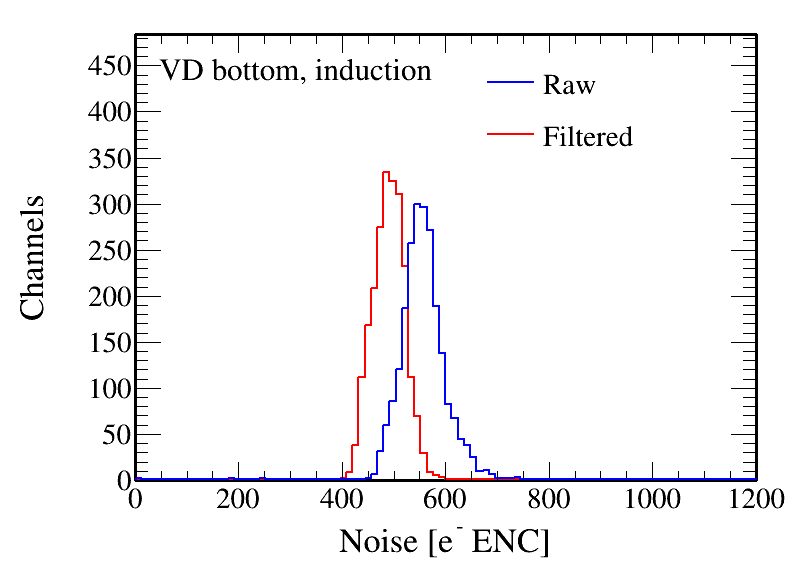

# Noise RMS per channel for ProtoDUNE-VD

These scripts measure the noise level of every channel, before and after the
Wire-Cell noise filter, and draw it as histograms in electrons (ENC =
equivalent noise charge).

Example data: ProtoDUNE-VD run 39252, first event of
`np02vd_raw_run039252_1176_df-s03-d3_dw_0_20250830T054542.hdf5`.

## Two steps

```
raw HDF5 --(step 1, lar)--> *_nf_stage1.root --(step 2, ROOT macro)--> rms_*.png
          raw + noise-filtered waveforms        noise per channel -> histograms
```

Both steps run inside the Fermilab SL7 container with `dunesw v10_21_02d00 -q e26:prof`
from `/cvmfs`. `launch_container.sh` starts the container; add the folders that hold
your data with `EXTRA_BINDS` (comma separated).

```bash
cd noise_rms

# Step 1: noise filter (a few minutes). Skip it if you already have the *_nf_stage1.root file.
EXTRA_BINDS=/where/data/is ./launch_container.sh step1_nf/run_nf_pdvd.sh \
    /where/data/is/np02vd_raw_run039252_1176_df-s03-d3_dw_0_20250830T054542.hdf5  ./nf_out

# Step 2: noise per channel + plots (1-2 minutes)
EXTRA_BINDS=/where/data/is ./launch_container.sh step2_rms/run_rms_pdvd.sh \
    ./nf_out/np02vd_raw_run039252_1176_df-s03-d3_dw_0_20250830T054542_nf_stage1.root  ./NF_plots
```

Step 2 writes into `NF_plots/run_<run>/evt_<event>/`:

| file | content |
|---|---|
| `rms_ind_<run>_<evt>.png` | bottom drift, induction planes: noise histogram, raw (blue) and filtered (red) |
| `rms_col_<run>_<evt>.png` | bottom drift, collection plane |
| `rms_ind_top_<run>_<evt>.png` | top drift, induction planes |
| `rms_col_top_<run>_<evt>.png` | top drift, collection plane |
| `rms_<run>_<evt>.png` | noise (ADC) vs channel number, all channels |
| `fft_*.png` | average noise frequency spectra (extra) |

`example_plots/` has the `rms_*.png` you should get from running both steps on the
example data (run 39252, event 298567).



## Files

| file | what it is |
|---|---|
| `step1_nf/wcls_nf_only_pdvd.fcl` | LArSoft job: decode the raw data, run only the Wire-Cell noise filter, keep both the raw (`tpcrawdecoder:daq`) and the filtered (`wclsdatavdnf:raw`) waveforms. First event only. |
| `step1_nf/standard_reco_pdvd_offline.fcl`, `step1_nf/wirecell_dune.fcl` | fcl files the job above includes. |
| `step1_nf/wcls-nf-fixed.jsonnet` | Wire-Cell configuration of the noise-filter job: dunesw's `pgrapher/experiment/protodunevd/wcls-nf.jsonnet` with one change, the noise filter reads all input waveforms (`intraces=''`). Without it the filter finds no input and writes empty waveforms. All other Wire-Cell config comes from dunesw. |
| `step2_rms/macro/convert_artroot_noise_plot.C` | Reads the artROOT file with `gallery`, fills a channel x time histogram for the raw and for the filtered waveforms (pedestal subtracted), then calls `Draw_RMS()` and `Draw_fft_ic()`. |
| `step2_rms/macro/all.h` | The analysis code. The noise calculation is described below. |
| `step2_rms/plotstyle.h`, `step2_rms/rootlogon.C.c` | Plot look only (fonts, margins); they do not change any number. |

## How the noise RMS is calculated (`all.h`)

1. **`get_rms(h1)`**: one channel's waveform.
   - First pass: plain mean and RMS over all time ticks.
   - Keep the ticks within 6 x RMS of the mean and fill a histogram of their ADC values.
   - Robust width from quantiles: with q16, q50, q84 the 16 %, 50 %, 84 % points,
     RMS = sqrt(((q84 - q50)^2 + (q16 - q50)^2) / 2).
     For pure Gaussian noise this equals the usual RMS, but real signals (particle
     tracks) in the waveform barely change it, so it measures the noise only.
2. **`get_rms_hist(h2)`**: runs `get_rms` on every channel and gives one RMS value
   (in ADC counts) per channel.
3. **`Draw_RMS()`**: converts ADC counts to electrons and fills the histograms.
   - Conversion: ENC [e-] = RMS [ADC] x (ADC range [mV] / 2^14) / gain [mV/fC] x 6241.5 [e-/fC].
     - Bottom drift (channels 0-6143): 1400 mV range. The gain is picked from the mean
       filtered RMS of the first 1000 channels: below 10 ADC means 7.8 mV/fC, i.e.
       **68.4 e-/ADC**; otherwise 14 mV/fC, i.e. 38.1 e-/ADC.
     - Top drift (channels 6144-12287): 2000 mV range, 11 mV/fC, i.e. **69.3 e-/ADC**.
   - Channels used (hard-coded, per readout plane group of 3069 channels):
     induction = channels 98-379 and 574-855 of the first induction plane and the
     same ranges shifted by 951 for the second; collection = 1903-3068.
     Only these channels enter the histograms (see the `if` blocks in `Draw_RMS`).
   - Histograms: 100 bins from 0 to 1200 e-. The first bin (0-12 e-) of the
     filtered histogram is emptied: it holds dead channels, not noise.
